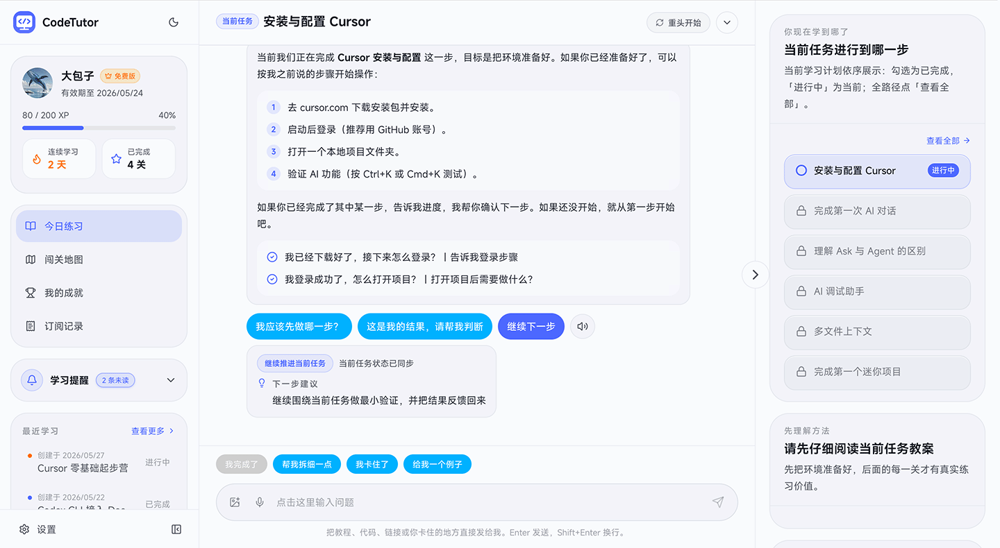
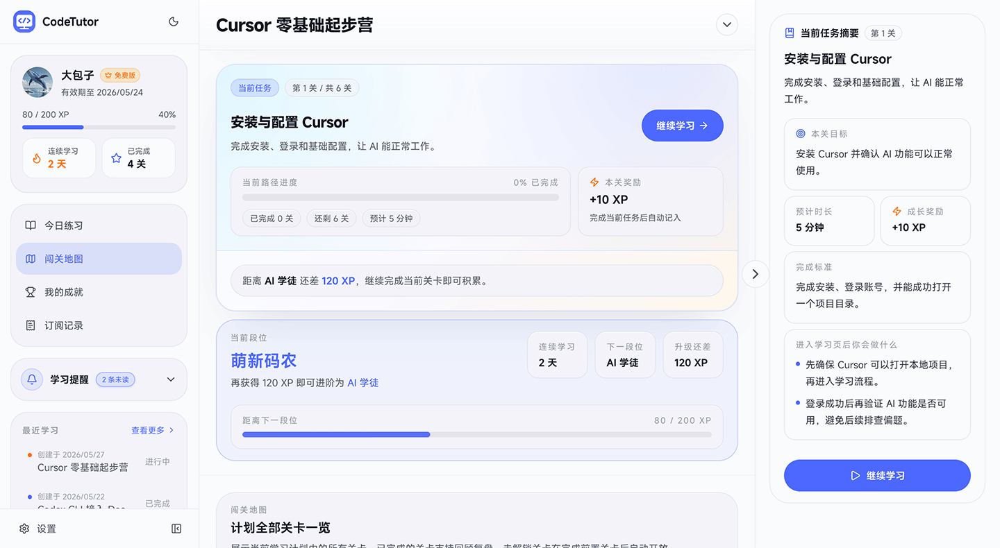
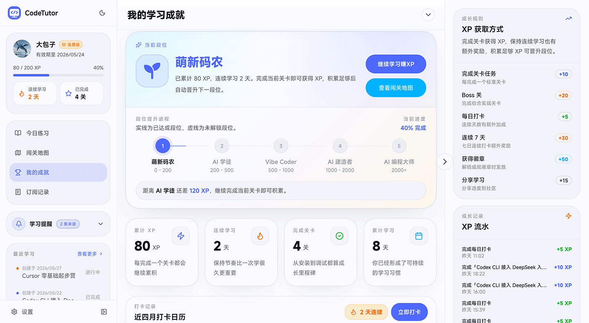
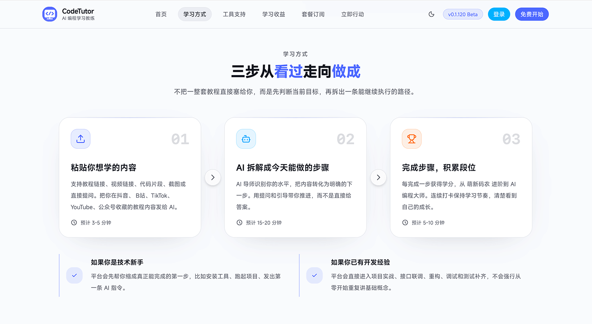
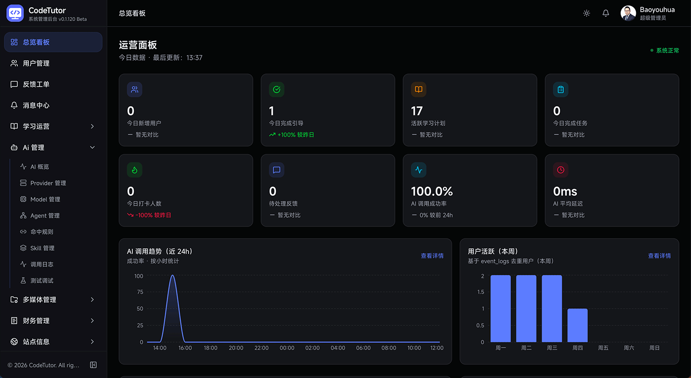

# CodeTutor

[](LICENSE)


[](https://github.com/ChengZhuo2025/codetutor/actions/workflows/ci.yml)

[English](README.md) | **简体中文**

CodeTutor 是面向中文学习者的 AI 编程学习陪练。它把零散教程、视频、代码片段和学习资料转化为可执行、可追踪、可反馈的学习路径，并提供 AI 对话陪练、任务推进、成就系统和运营后台。

这个仓库是一个基于 Next.js App Router、Supabase、TypeScript 和可扩展 AI Provider 层的全栈 MVP，包含用户端学习工作台、管理后台、API 路由、服务模块、Supabase 迁移和产品/架构规划文档。

## 产品截图

| AI 学习对话 | 学习地图 | 成就系统 |
|:---:|:---:|:---:|
|  |  |  |
| *流式 AI 对话 · 多模态素材 · TTS 朗读* | *学习路径可视化 · 进度追踪* | *每日签到 · 成就徽章 · 积分激励* |

| 教程导入 | 管理后台 | API 文档 |
|:---:|:---:|:---:|
|  |  |  |
| *粘贴链接 → AI 解析生成学习计划* | *用户/学习/AI/财务 全功能管理* | *Swagger UI 交互式 API 文档* |

> 💡 截图文件请放置在 `public/screenshots/` 目录下。推荐分辨率：`1280×720`，格式：PNG 或 WebP。

## 为什么做 CodeTutor

### 问题：学编程的"最后一公里"

中文互联网不缺编程教程——B站、掘金、知乎、慕课网，到处是好内容。但**"看过"和"做成"之间有巨大的鸿沟**：

- 📚 收藏了 100 个教程，真正跟完的不到 3 个
- 🎯 不知道当前水平该学什么、按什么顺序学
- 🤷 卡住了没人问，Google 半天也找不到对症的答案
- 📉 学了就忘，没有追踪、没有反馈、没有成就感

### 方案：不是"另一个看视频的平台"

CodeTutor 不生产教程，它**把已有教程变成可执行的 AI 陪练计划**：

1. **粘贴任意教程链接** → AI 自动解析内容，生成带关卡的学习计划
2. **AI 教练实时陪练** → 流式对话、追问解释、检查代码、拆解下一步任务
3. **让进步看得见** → 学习地图可视化、每日签到、成就徽章、积分体系
4. **自部署、可扩展** → AGPL-3.0 开源，Supabase + Next.js 全栈，AI 供应商可替换

### 适合谁

| 角色 | 使用场景 |
|------|---------|
| 🧑‍💻 编程学习者 | 把散乱教程转化为有反馈、有追踪的 AI 陪练学习 |
| 👨‍🏫 培训机构/老师 | 自部署学员管理系统，AI 辅助教学 |
| 🏗️ 开发者 | 学习 Next.js 16 全栈实战架构、AI provider 抽象设计 |
| 🔬 研究者 | 二次开发学习行为分析、AI 教学效果评估 |

## 当前状态

CodeTutor 当前是一个“已具备核心链路的全栈 MVP”，但还不是零配置的一键部署发行版。

已落地能力包括：

- 手机优先登录、微信/抖音身份绑定、首页登录态恢复、Onboarding、用户资料、头像上传和反馈。
- 用户端学习工作台：AI 学习对话、SSE 流式回复、图片/语音附件、AI 回复语音播放、任务完成、每日打卡、成就、历史学习和订单。
- 自主教程链接摄取：异步材料规划、多模态证据提取、质量闸门、可编辑计划草稿和事务化确认。
- 管理后台：看板、用户运营、学习路径/模板、AI Provider/Model/Agent/多媒体配置、站点信息、帮助中心、更新日志、消息中心、系统设置、财务和反馈。
- 微信 Native / 支付宝扫码支付配置、订阅权益开通、订单管理、通知设置、埋点事件接收和 OpenAPI 文档。
- Supabase 数据库迁移已提交到 `057`。

仍在规划或部分实现中的能力包括：

- 更细粒度的后台权限。
- 内部备注、手动学分调整、退款、自动续费、JSAPI/H5 支付、财务导出、发票和更深的对账。
- 后续 AI 编排运营能力，例如 Prompt 版本管理、灰度发布、更完整的成本/稳定性看板和共享队列基础设施。

## 技术栈

| 层级 | 技术 |
| --- | --- |
| 应用框架 | Next.js 16.2 App Router |
| UI 运行时 | React 19.2 |
| 语言 | TypeScript 5.7 |
| 样式 | Tailwind CSS 4.2、shadcn/ui 风格组件 |
| 数据校验 | Zod、zod-to-openapi |
| 后端 | Next.js Route Handlers + `server/modules` 服务层 |
| 数据库 | Supabase PostgreSQL |
| 文件存储 | Supabase Storage |
| AI 层 | `ai/` 与 `server/modules` 下的 Provider / Agent / Skill 抽象 |
| 包管理器 | pnpm |
| Node.js | 推荐 22.18.0 |

## 项目结构

```text
app/                     Next.js App Router 页面和 API 路由
app/api/                 BFF/API 路由处理器
ai/                      AI Provider、Agent、Skill 编排辅助代码
components/              共享布局与 UI 基础组件
constants/               跨 feature 常量
docs/plans/              PRD、架构、API、Schema 和路线规划文档
features/                Feature 页面、组件、静态数据和 view model
hooks/                   共享 React hooks
lib/                     API 客户端、工具函数和 Supabase 客户端
providers/               React Context providers
public/                  静态资源
scripts/                 定向验证脚本
server/lib/              服务端通用工具
server/modules/          按业务域组织的服务模块
supabase/migrations/     数据库迁移
types/                   共享 TypeScript 类型
```

核心约定：

- `app/` 保持薄层装配，页面逻辑放在 `features/`。
- 只被一个业务域使用的组件放在 `features/<domain>/components`；跨业务复用组件放在 `components/`。
- API 契约变化需要同步 `server/modules/api-docs/openapi.ts` 和 `server/modules/api-docs/schemas.ts`。
- 数据库或环境变量变化需要同步迁移、`.env.example` 和相关规划文档。

## 快速开始

### 前置条件

- Node.js `22.18.0`
- pnpm
- 一个本地或远程 Supabase 项目

### 安装与运行

```bash
pnpm install
cp .env.example .env.local
```

在 `.env.local` 中填入必要的 Supabase 和 Provider 配置。不要提交真实密钥。

```bash
pnpm dev
```

访问 `http://localhost:3000`。管理后台位于 `/admin`，需要管理员账号。

### 数据库

数据库 schema 位于 `supabase/migrations/`，当前已提交到迁移 `057`。

**方案 A：使用远程 Supabase 项目（推荐快速开始）**

1. 在 [supabase.com](https://supabase.com) 创建免费项目
2. 从 **Settings > API** 获取项目 URL、anon key 和 service_role key
3. 在 `.env.local` 中填入 `NEXT_PUBLIC_SUPABASE_URL`、`NEXT_PUBLIC_SUPABASE_ANON_KEY` 和 `SUPABASE_SERVICE_ROLE_KEY`
4. 通过 Supabase Dashboard SQL 编辑器或辅助脚本应用迁移：

   ```bash
   pnpm db:run:file supabase/migrations/001_init.sql
   # 按编号顺序依次执行 002 到 057，或拼接后一次性执行
   ```

5. 验证连接：

   ```bash
   pnpm db:check
   ```

**方案 B：本地 Supabase（通过 Supabase CLI）**

1. 安装 [Supabase CLI](https://supabase.com/docs/guides/cli)
2. 启动本地环境：

   ```bash
   supabase init   # 首次使用
   supabase start
   ```

3. 将 CLI 输出的本地 URL 和 keys 填入 `.env.local`
4. 应用所有已入库的迁移：

   ```bash
   # Supabase CLI 会自动读取 supabase/migrations/ 目录
   supabase db push
   # 也可以使用辅助脚本配合本地 DATABASE_* 变量：
   pnpm db:check
   ```

目前还没有一条命令完成本地 Supabase 初始化的体验。欢迎贡献者参与改善本地开发环境搭建流程。

## 常用脚本

```bash
pnpm dev
pnpm build
pnpm start
pnpm lint
pnpm test:openapi-document
pnpm test:admin-users
pnpm test:admin-learning
pnpm test:admin-ai
pnpm test:admin-site
pnpm test:admin-settings
pnpm test:payment
pnpm test:workspace-sidebar
pnpm test:workspace-shell-collapse
```

`scripts/` 目录下还有更多定向验证脚本。修改哪个区域，就优先运行覆盖该区域的最小验证脚本。

## 文档索引

建议从这些文档开始：

- [docs/plans/README.md](docs/plans/README.md)
- [产品需求文档](docs/plans/2026-03-23-ai-coding-tutor-prd.md)
- [技术架构设计](docs/plans/2026-03-23-ai-coding-tutor-technical-architecture.md)
- [API 规范](docs/plans/2026-03-23-ai-coding-tutor-api-spec.md)
- [数据库 Schema 设计](docs/plans/2026-03-23-ai-coding-tutor-database-schema-design.md)
- [AI 编排设计](docs/plans/2026-03-30-ai-coding-tutor-ai-orchestration-design.md)
- [管理后台设计](docs/plans/2026-03-31-ai-coding-tutor-admin-console-design.md)

当文档与代码不一致时，以代码和迁移文件为准，再回写文档。

## 贡献

欢迎贡献。适合优先参与的方向包括：文档、本地开发体验、定向测试脚本、UI 细节、问题复现和小范围服务层修复。

提交 Pull Request 前：

1. 阅读 [CONTRIBUTING.md](CONTRIBUTING.md)。
2. 保持改动范围清晰且聚焦。
3. 运行能覆盖改动的最小验证命令。
4. 不要提交密钥、生产凭据、用户数据或私有运营备注。

提交贡献即表示你同意你的贡献按 `AGPL-3.0-only` 授权。

## 安全

请不要通过公开 issue 报告安全漏洞。私下报告方式和密钥处理要求见 [SECURITY.md](SECURITY.md)。

## 许可证

CodeTutor 使用 **GNU Affero General Public License v3.0 only** 授权。

Copyright (C) 2026 Shanghai Zhiku Shuneng Technology Co., Ltd.（上海智酷数能科技有限公司）。

SPDX 标识：

```text
AGPL-3.0-only
```

你可以使用、修改、自部署，并基于本软件提供商业服务。若你修改 CodeTutor 并通过网络服务向用户提供，你必须按 AGPL-3.0 向这些用户提供对应源码。

完整许可证文本见 [LICENSE](LICENSE)。

## 商标和品牌

CodeTutor 名称、Logo、域名 `www.codetutor.cn` 及所有官方服务品牌归 **上海智酷数能科技有限公司（Shanghai Zhiku Shuneng Technology Co., Ltd.）** 所有，不随 AGPL-3.0 授权。Fork 或自部署版本不得暗示自己是官方 CodeTutor 服务，也不得在可能造成背书或关联误解的场景下使用 CodeTutor 名称和品牌，除非获得明确书面许可。

生产凭据、私有用户数据、托管服务数据和私有基础设施配置不属于开源发布内容。
