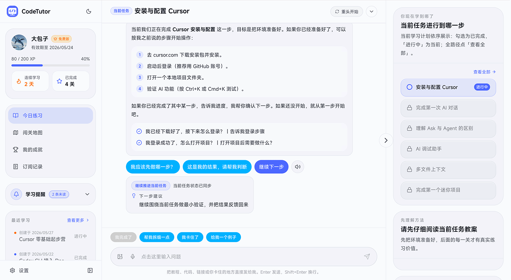
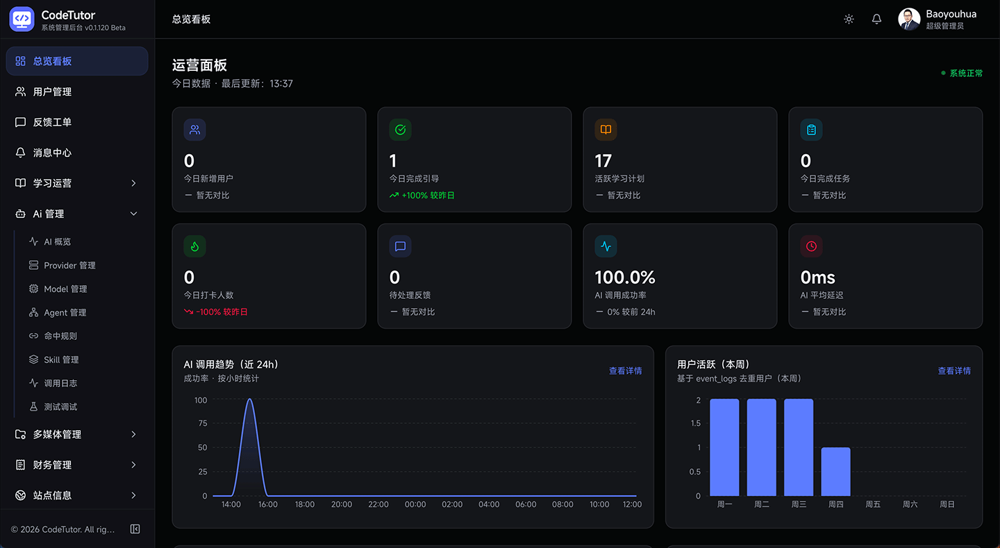

## 一、收藏从未停止，学习从未开始

做开发这些年，我的收藏夹里躺着上百个「必看」教程——B站的、掘金的、YouTube的、某慕课的。每次看到好内容就点收藏，然后...就没有然后了。

我相信这不是我一个人的问题。中文互联网的编程教程数量已经爆炸，但真正能**从头跟到尾**的人凤毛麟角。不是因为内容不好，而是因为：

- 📚 **缺少结构化**：碎片教程没有「先学A再学B」的路径
- 🤷 **卡住没人问**：遇到报错，Google 半天找不到对症答案
- 📉 **学了就忘**：没有追踪、没有反馈、没有成就感

于是我花了大半年时间，用 Next.js 16 + Supabase 从零搭建了一个解决这个问题的工具，取名叫 **CodeTutor**。现在把它完整开源了。

> 🏠 仓库地址：[github.com/ChengZhuo2025/codetutor](https://github.com/ChengZhuo2025/codetutor)
> 🪪 License：AGPL-3.0-only

## 二、CodeTutor 是做什么的？

一句话概括：**把任意编程教程链接，变成一个带 AI 教练的闯关式学习计划。**

具体来说：

1. 你粘贴一个教程链接（B站视频、掘金文章、知乎专栏、任意网页）
2. AI 自动解析内容，提取知识点，生成带关卡的学习计划
3. 你打开学习工作台，AI 教练通过流式对话引导你一步步完成
4. 每完成一个任务，获得积分、升级段位、解锁成就
5. 管理者可以通过后台运营用户、配置 AI 供应商、查看数据



## 三、技术架构全景

CodeTutor 是一个**单仓库全栈项目**，技术选型如下：

| 层 | 技术 | 说明 |
|---|------|------|
| 框架 | Next.js 16.2 App Router | 服务端渲染 + API 路由同仓 |
| UI | React 19.2 + Tailwind CSS 4.2 + shadcn/ui | 暗色主题优先 |
| 语言 | TypeScript 5.7 严格模式 | 全链路类型安全 |
| 数据库 | Supabase PostgreSQL | 含 57 个迁移文件 |
| 存储 | Supabase Storage | 头像、附件上传 |
| 校验 | Zod + zod-to-openapi | 运行时校验 + API 文档自动生成 |
| AI 层 | 自研 Provider 抽象 | 已接通硅基流动，可替换任意供应商 |
| 包管理 | pnpm | monorepo 就绪 |
| CI/CD | GitHub Actions | 自动 lint + build |

### 目录结构

```text
app/                   # Next.js App Router 路由入口（薄层装配）
app/api/               # BFF / API 路由
ai/                    # AI provider、agent、skill 编排层
components/            # 跨域共享 UI 组件
constants/             # 跨 feature 常量（事件名等）
docs/plans/            # 产品/架构/API/数据库设计文档
features/              # 前端主工作目录，按业务域组织
hooks/                 # 自定义 React Hooks
lib/                   # 工具函数、API 契约、Supabase 客户端
public/                # 静态资源
scripts/               # 功能验证脚本（100+ 个）
server/lib/            # 服务端共享工具
server/modules/        # 按域划分的业务服务层
supabase/migrations/   # 数据库迁移（001-057）
types/                 # 跨域共享类型
```

核心架构约束只有两条：

1. **`app/` 只做路由入口，不承载业务逻辑**
2. **组件按域归属：单域 → `features/<domain>/components`，多域复用 → `components/`**

这种约束的好处是，新人看代码不会迷失在 `app/` 的 50 个文件里，业务逻辑全部在 `server/modules/` 和 `features/` 中按域组织。

## 四、四个值得分享的实现亮点

### 4.1 AI Provider 抽象层：不只是「调一个 API」

项目没有把 AI 调用硬编码为「调 OpenAI」。而是设计了一个 **Provider → Model → Agent → Binding → Skill** 五层抽象：

```
User Request
    ↓
Binding（用户请求 → Agent 映射）
    ↓
Agent（系统提示词 + 模型 + 参数 + Skill 装配）
    ↓
Model（具体模型实例，含上下文窗口、费用等元数据）
    ↓
Provider（硅基流动 / OpenAI / 自定义，含密钥加密存储）
```

关键设计决策：

- **Provider 密钥加密存储**：数据库存密文，运行时 `AI_PROVIDER_SECRET_ENCRYPTION_KEY` 解密，支持管理后台脱敏展示和按需明文读取
- **配置快照缓存**：Provider/Model/Agent/Binding/Skill 配置读一次后缓存，避免每条消息都查库
- **JSON / SSE 双模式**：AI 响应支持 JSON（结构化任务补丁）和 SSE（流式对话），同一接口通过 `Accept` 头区分

```typescript
// ai/provider.ts 核心接口
interface AIProvider {
  chat(request: ChatRequest): AsyncGenerator<ChatChunk>;
  models(): Promise<Model[]>;
}

// 新增供应商只需实现这两个方法
class SiliconFlowProvider implements AIProvider { ... }
class OpenAIProvider implements AIProvider { ... }
```

### 4.2 学习计划状态机：不只是 CRUD

学习计划不是一个简单的「创建/更新/删除」，而是一个完整的**五态状态机**：

```
onboarding → active ⇄ interrupted
               ↓           ↓
           completed   abandoned → archived
```

- `active`：用户正在学习
- `interrupted`：连续 7 天无学习行为，系统自动中断（通过定时脚本检查 `last_activity_at`）
- `completed`：所有任务完成
- `abandoned`：用户主动放弃，不可再激活
- `archived`：软删除归档

这个设计避免了「用户创建了 50 个计划但一个都没完成」的数据腐化问题，也让管理后台能够区分「正在学」「已放弃」「已完成」的用户群体。

### 4.3 流式对话 + 结构化输出双通道

学习对话是最核心的交互，技术上有三个挑战：

**挑战 1：AI 需要同时返回「给人看的话」和「给系统执行的指令」**

解决方案：SSE 流中同时携带 `content`（展示文本）和 `structuredContent`（结构化操作指令，如 `task_patch`）：

```typescript
// SSE 事件格式
event: message
data: {"type":"text","content":"好的，让我们开始第一步..."}

event: message
data: {"type":"task_patch","structuredContent":{"task_id":"t_001","status":"in_progress"}}
```

**挑战 2：多模态素材处理**

用户可能粘贴链接、上传图片、发送语音。系统需要：
- URL 自动抓取并解析为 Markdown
- 图片通过 Supabase Storage 上传，生成 URL 传给 AI
- 语音转文字后再送入对话上下文

**挑战 3：流式响应的安全边界**

SSE 连接需要鉴权、限流、超时控制。系统实现了：
- Bearer Token 鉴权 + 短 TTL 缓存
- 每用户每分钟 30 条消息的限流
- 连接 120 秒超时自动断开

### 4.4 管理后台：开源项目也需要运营能力

很多开源项目只关注用户端，但 CodeTutor 同时交付了完整的**运营后台**：

| 模块 | 能力 |
|------|------|
| 看板总览 | 用户数、学习计划数、消息量趋势 |
| 用户运营 | 列表筛选、详情、CSV 导出、资料编辑、软删除 |
| 学习记录 | 路径列表/导出、会话摘要、状态操作（reactivate/archive） |
| AI 管理 | Provider/Model/Agent/Binding/Skill 全生命周期管理 |
| 系统设置 | 管理员治理、账号启停、审计日志 |
| 财务 | 订单管理、支付配置、财务统计 |
| 站点 | 帮助中心、变更日志、通知管理 |



这些能力让 CodeTutor 不仅仅是一个「demo 项目」，而是一个可以直接用于小规模教学的**生产级 MVP**。

## 五、踩过的坑和学到的经验

### 坑 1：Next.js 16 App Router 的缓存行为

Next.js 16 默认激进缓存，导致登录态恢复后页面数据不刷新。解决方案是在需要实时数据的 layout 中显式设置 `export const dynamic = 'force-dynamic'`，并在 Provider 层做客户端缓存而非依赖服务端缓存。

### 坑 2：Supabase 迁移管理

57 个迁移文件的管理是个挑战。我们约定：
- 每个迁移文件只做一件事
- 迁移不可回滚（只增不改）
- 通过 `scripts/` 下的脚本做自动化验证

### 坑 3：pnpm 依赖锁定

项目使用了 `swagger-ui-react` 做 API 文档展示，它引入了大量传递依赖。通过 pnpm overrides 精确锁定了 `axios`、`dompurify` 等有安全漏洞的传递依赖版本，58 个 Dependabot 告警全部清零。

## 六、如何参与

CodeTutor 采用 **AGPL-3.0-only** 许可证。你可以自由使用、修改、自部署，但如果将修改版作为网络服务提供，需要同时开放源码。

### 快速开始

```bash
git clone git@github.com:ChengZhuo2025/codetutor.git
cd codetutor
pnpm install
cp .env.example .env.local
# 填入 Supabase 和 AI Provider 密钥
pnpm dev
```

### 适合贡献的方向

- 📖 文档改进、本地部署体验优化
- 🧪 补充测试脚本（项目已有 100+ 验证脚本，欢迎继续扩展）
- 🎨 UI 打磨和移动端适配
- 🐛 Issue 复现和修复
- 🔌 接入更多 AI Provider（目前支持硅基流动和 OpenAI 兼容接口）

详细的贡献指南见 [CONTRIBUTING.md](https://github.com/ChengZhuo2025/codetutor/blob/main/CONTRIBUTING.md)。

## 七、下一步

项目当前是 **0.1.110** 版本，已具备核心学习链路和运营后台。接下来计划：

- 更细粒度的管理员权限控制
- 退款、发票、自动续费等财务深水区
- Prompt 版本管理和 A/B 测试能力
- 一键本地 Supabase 部署脚本

如果你对「AI + 教育」方向感兴趣，或者正在学习 Next.js 全栈开发，欢迎来玩：

> 🏠 [github.com/ChengZhuo2025/codetutor](https://github.com/ChengZhuo2025/codetutor)

---

*本文由 CodeTutor 作者撰写，项目完全开源。如果觉得有用，欢迎 Star ⭐️*
