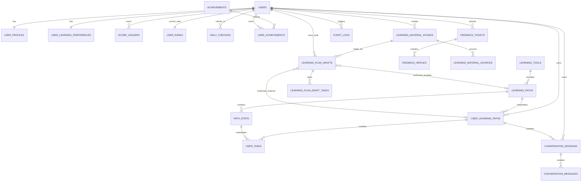

# AI编程学习教练 数据库 Schema 设计文档

> 文档类型：数据库 Schema 设计文档  
> 产品名称：AI编程学习教练  
> 版本：v1.2  
> 状态：已按当前迁移与代码实现同步  
> 创建日期：2026-03-23  
> 适用阶段：MVP  
> 关联文档：`docs/plans/2026-03-23-ai-coding-tutor-technical-architecture.md`

---

## 1. 文档目标

本文档定义 AI编程学习教练 MVP 的关系型数据库设计，覆盖核心表结构、字段说明、约束、索引、枚举、关键查询场景和数据一致性规则，作为后续建表、迁移、接口开发和数据分析的依据。

数据库默认选型：

- `阿里云 AnalyticDB PostgreSQL 版 Supabase`

### 1.1 当前迁移实现快照

当前仓库并不是只有数据库设计文档，已经存在真实迁移并已连接远程 Supabase。

当前已落地迁移：

- `001_init.sql`
- `002_fix_update_updated_at_search_path.sql`
- `003_promote_profile_contact_fields.sql`
- `004_add_profile_auth_tracking_fields.sql`
- `005_create_user_profile_export_view.sql`
- `006_expand_user_profile_export_view_metrics.sql`
- `007_create_profile_avatar_bucket.sql`
- `008_add_feedback_tickets.sql`
- `009_add_interrupted_learning_path_status.sql`
- `010_create_growth_write_models.sql`
- `011_create_daily_checkins.sql`
- `012_create_ai_conversation_core.sql`
- `013_create_ai_provider_registry.sql`
- `014_create_ai_agent_registry.sql`
- `015_create_ai_skill_registry.sql`
- `016_create_llm_invocations.sql`
- `017_create_admin_accounts.sql`
- `018_create_learning_material_plan_tables.sql`
- `019_admin_user_soft_delete.sql`
- `020_create_analytics_and_notifications.sql`
- `021_add_ai_provider_encrypted_secrets.sql`
- `022_add_admin_test_session_flag.sql`
- `023_add_optimistic_lock_version.sql`
- `024_async_material_plan_runs.sql`
- `025_material_plan_editable_drafts.sql`
- `026_learning_material_chunks_evidence_metadata.sql`
- `027_material_plan_mastery_and_cautions.sql`
- `028_add_ai_model_profile_fields.sql`
- `029_create_site_contact_settings.sql` (新增企业联系方式配置表，支持管理后台编辑，供营销联系对话框动态加载)
- `034_create_payment_subscription_tables.sql` (新增微信 Native 支付配置、订阅套餐、支付订单、用户订阅与支付回调事件表；`035_harden_payment_order_completion.sql` 新增支付完成幂等 RPC；`030`-`033` 为联系方式二维码与 RLS 修正迁移)

当前数据库中已落地的核心业务表包括：

- `user_profiles`
- `user_learning_preferences`
- `learning_tools`
- `learning_paths`
- `path_steps`
- `user_learning_paths`
- `user_tasks`
- `score_ledgers`
- `user_ranks`
- `daily_checkins`
- `feedback_tickets`
- `feedback_replies`
- `conversation_sessions`
- `conversation_messages`
- `ai_providers`
- `ai_models`
- `agent_templates`
- `agent_bindings`
- `skill_packs`
- `agent_skill_bindings`
- `llm_invocations`
- `learning_material_intakes`
- `learning_material_sources`
- `learning_plan_drafts`
- `learning_plan_draft_tasks`
- `event_logs`
- `user_notification_settings`
- `user_notifications`

其中 `ai_providers` 当前除基础连接字段外，还包含 Provider API Key 加密托管所需字段：

- `secret_ref`：兼容环境变量回退引用，可为空
- `secret_ciphertext` / `secret_iv` / `secret_auth_tag`：API Key 密文与解密参数
- `secret_key_version`：加密主密钥版本
- `secret_last_updated_at`：最近一次密钥更新时间

当前尚未通过迁移落地、仍属于后续设计的表包括：

- `achievements`
- `user_achievements`

因此，本文档后续章节如果描述了 `achievements`、`user_achievements` 等对象，应视为“后续规划建模”；其余 AI 会话 / provider / agent / skill / invocation / analytics / notifications 相关表已经是当前远程数据库中的既有对象。

补充说明：

- 当前 `/achievements` 页已开始优先读取 `user_ranks`、`score_ledgers` 与 `daily_checkins`，成就定义、用户成就等仍未落地，因此仍会辅以 `user_profiles`、`user_tasks`、`user_learning_paths` 做部分聚合。

---

## 2. 设计原则

### 2.1 事务数据优先关系型建模

用户、路径、任务、会话、学分、成就之间关联明确，对一致性要求高，优先使用关系型表建模。

### 2.2 权威状态单点存储

任务状态、积分状态、当前主工具、当前段位等权威状态必须有明确归属，避免重复冗余造成漂移。

### 2.3 流水优先于覆盖

凡是需要审计、追踪、回溯和修复的状态变化，如积分发放、段位变更、任务完成，应优先保留流水。

### 2.4 模板与实例分离

学习路径模板和用户任务实例必须分离，便于：

- 路径复用
- 后续版本迭代
- 用户个性化派生

### 2.5 先支撑 MVP，再考虑扩展

首版不引入过多抽象层，但所有核心表保留必要扩展字段，如 `metadata`、`version`、`source_type`。

### 2.6 区分存储模型与页面读模型

当前前端原型已经形成较完整的页面结构，但并不意味着页面上的每个字段都应该直接落库。

- 页面读模型可以包含聚合字段，例如 `progress.percent`、`nextRankRemainingXP`、`checkedInToday`
- 数据库存储模型只保存权威事实、状态快照和必要流水
- 图标、颜色、FAQ、套餐文案、按钮辅助文案等展示信息保持前端静态配置，不作为首期数据库字段

本次 schema 校准重点围绕：

1. 让 `/onboarding` 能产出真实的用户路径实例
2. 让 `/learn`、`/map`、`/history` 共用同一条学习路径实例主线
3. 让 `/achievements` 的 XP、段位、勋章、打卡来源清晰可追溯

---

## 3. Schema 总览

建议按以下逻辑域组织数据库：

1. 认证与用户域
2. 学习路径与任务域
3. 对话与 AI 域
4. 成长与激励域
5. 分析与审计域

当前已落地核心表：

- `auth.users`
- `public.user_profiles`
- `public.user_learning_preferences`
- `public.learning_tools`
- `public.learning_paths`
- `public.path_steps`
- `public.user_learning_paths`
- `public.user_tasks`
- `public.feedback_tickets`
- `public.feedback_replies`
- `public.learning_material_intakes`
- `public.learning_material_sources`
- `public.learning_plan_drafts`
- `public.learning_plan_draft_tasks`

已落地 AI / 运营扩展表：

- `public.conversation_sessions`
- `public.conversation_messages`
- `public.ai_providers`
- `public.ai_models`
- `public.agent_templates`
- `public.agent_bindings`
- `public.skill_packs`
- `public.agent_skill_bindings`
- `public.llm_invocations`
- `public.event_logs`

补充说明：

- `public.ai_models` 已在 `028_add_ai_model_profile_fields.sql` 中补齐结构化画像字段：`model_family`、`runtime_capabilities`、`connection_test_mode`、`reasoning_enabled`、`profile_group`、`notes`；运行时先读这些主字段，再兼容历史 `metadata` 中的同义 key。

---

## 4. ER 关系图

说明：`learning_plan_drafts.superseded_by_draft_id` 为草稿自引用外键（再生稿替换旧稿），上图未单独画出自环边。

---

## 5. 枚举设计

建议使用 Postgres enum 或受控字符串。

## 5.1 `learning_level`

- `beginner`
- `intermediate`
- `advanced`

## 5.2 `task_status`

- `not_started`
- `in_progress`
- `blocked`
- `completed`
- `archived`

## 5.3 `conversation_status`

- `active`
- `completed`
- `abandoned`

## 5.4 `message_role`

- `user`
- `assistant`
- `system`

说明：

- 服务端持久化建议统一使用 `assistant`
- 若前端展示层仍沿用 `ai`，应在 DTO 或 BFF 层做映射，不在数据库层引入重复枚举

## 5.5 `message_content_type`

- `text`
- `link`
- `code`
- `image`
- `system_feedback`

## 5.6 `score_event_type`

- `task_completed`
- `daily_checkin`
- `project_completed`
- `manual_adjustment`
- `achievement_reward`

## 5.7 `rank_code`

- `rookie`
- `apprentice`
- `vibe_coder`
- `builder`
- `master`

## 5.8 `event_source`

- `web`
- `api`
- `system`

## 5.9 `path_selection_mode`

- `self_directed`
- `preset_training`

## 5.10 `user_learning_path_status`

- `active`
- `interrupted`
- `completed`
- `abandoned`
- `archived`

补充语义：

- `active`：当前进行中的唯一学习计划
- `interrupted`：系统自动判定中断，当前规则为连续 7 天无学习行为
- `completed`：整条学习计划正常完成
- `abandoned`：用户主动放弃本轮练习；历史记录保留，之后仍可在历史页重新激活
- `archived`：历史记录软删除，仅用于隐藏，不再出现在用户历史列表

## 5.11 `feedback_type`

- `visual_design`
- `interaction_flow`
- `feature_request`
- `issue_report`

## 5.12 `feedback_status`

- `submitted`
- `in_review`
- `replied`
- `closed`

## 5.13 `feedback_priority`

- `low`
- `medium`
- `high`

## 5.14 `feedback_reply_author_type`

- `user`
- `admin`
- `system`

## 5.15 `learning_material_intake_status`

- `pending`：用户提交但还未入队
- `queued`：输入合法、已排队等待 worker 摄取
- `processing`：已有 intake worker 持续执行（旧同步状态）
- `extracting`：正在拉取字幕/文本/媒体
- `planning`：planner agent 输出草稿
- `quality_checking`：质量闸门与二次校验
- `ready`：草稿可编辑、可确认
- `succeeded`：旧状态，计划已确认激活
- `failed`：摄取或规划失败

## 5.16 `learning_material_source_type`

- `article`
- `video`
- `unknown`

## 5.17 `learning_material_fetch_status`

- `succeeded`
- `failed`
- `unsupported`
- `timeout`

## 5.18 `learning_plan_draft_status`

- `draft`：可确认或可再生成
- `confirmed`：已物化到 `learning_paths` / `user_learning_paths`，接口幂等短路
- `rejected`：预留，当前业务流较少使用
- `superseded`：被同用户新草稿替换，`superseded_by_draft_id` 指向新草稿

---

## 6. 表结构设计

## 6.1 `user_profiles`

用途：

- 保存用户扩展档案与当前学习状态

主键：

- `user_id uuid`，引用 `auth.users.id`

字段建议：

| 字段 | 类型 | 约束 | 说明 |
|------|------|------|------|
| `user_id` | `uuid` | PK, FK | 用户主键 |
| `nickname` | `varchar(64)` | nullable | 昵称 |
| `avatar_url` | `text` | nullable | 头像 |
| `wechat` | `varchar(64)` | nullable | 微信号 |
| `contact_email` | `varchar(255)` | nullable | 业务联系邮箱，独立于 auth 登录邮箱 |
| `bio` | `text` | nullable | 个人简介 |
| `signup_provider` | `varchar(32)` | nullable | 首次注册来源，如 `phone`、`wechat` |
| `last_login_provider` | `varchar(32)` | nullable | 最近一次登录方式 |
| `last_login_at` | `timestamptz` | nullable | 最近一次登录时间 |
| `primary_tool_id` | `uuid` | FK, nullable | 当前主学习工具 |
| `learning_level` | `learning_level` | not null | 当前学习等级 |
| `current_rank_code` | `rank_code` | not null | 当前段位 |
| `current_score` | `integer` | not null default 0 | 当前积分快照 |
| `streak_days` | `integer` | not null default 0 | 连续学习天数 |
| `last_learning_at` | `timestamptz` | nullable | 最近学习时间 |
| `last_active_task_id` | `uuid` | nullable | 最近活跃任务 |
| `metadata` | `jsonb` | not null default '{}' | 低频扩展字段，不再承载微信号、联系邮箱、个人简介、注册来源 |
| `created_at` | `timestamptz` | not null | 创建时间 |
| `updated_at` | `timestamptz` | not null | 更新时间 |

索引建议：

- `idx_user_profiles_primary_tool_id`
- `idx_user_profiles_learning_level`

导出建议：

- 建议提供 `public.user_profile_export_view` 作为后台运营导出视图，统一聚合 `user_profiles`、`auth.users`、`user_learning_preferences` 与当前 `active` 学习路径，避免每次导出时重复手写 join。
- 视图建议包含常看运营指标，如 `completed_task_count_total`、`active_path_total_steps`、`active_path_completed_steps`、`active_path_completion_percent`、进行中任务数、待开始任务数。

## 6.2 `user_learning_preferences`

用途：

- 保存用户学习偏好与引导结果

字段建议：

| 字段 | 类型 | 约束 | 说明 |
|------|------|------|------|
| `id` | `uuid` | PK | 主键 |
| `user_id` | `uuid` | FK, unique | 用户 ID |
| `preferred_tool_ids` | `jsonb` | not null default '[]' | 偏好工具列表 |
| `onboarding_completed` | `boolean` | not null default false | 是否完成新手引导 |
| `primary_tool_id` | `uuid` | FK, nullable | 首次引导确认的主学习工具 |
| `selected_path_id` | `uuid` | FK, nullable | 首次引导选中的模板路径 |
| `selection_mode` | `path_selection_mode` | nullable | `self_directed` / `preset_training` |
| `goal_summary` | `text` | nullable | 学习目标摘要 |
| `content_language` | `varchar(16)` | not null default 'zh-CN' | 内容语言 |
| `metadata` | `jsonb` | not null default '{}' | 扩展字段，如首次引导快照、候选路线记录 |
| `created_at` | `timestamptz` | not null | 创建时间 |
| `updated_at` | `timestamptz` | not null | 更新时间 |

## 6.3 `learning_tools`

用途：

- 工具字典表

字段建议：

| 字段 | 类型 | 约束 | 说明 |
|------|------|------|------|
| `id` | `uuid` | PK | 主键 |
| `code` | `varchar(64)` | unique | 工具代码，如 `cursor` |
| `name` | `varchar(64)` | not null | 工具名称 |
| `tool_type` | `varchar(32)` | not null | `gui` / `cli` / `lightweight` |
| `difficulty_level` | `learning_level` | not null | 推荐适用等级 |
| `is_active` | `boolean` | not null default true | 是否启用 |
| `sort_order` | `integer` | not null default 0 | 排序 |
| `metadata` | `jsonb` | not null default '{}' | 描述、推荐文案等 |
| `created_at` | `timestamptz` | not null | 创建时间 |
| `updated_at` | `timestamptz` | not null | 更新时间 |

索引建议：

- `uidx_learning_tools_code`
- `idx_learning_tools_tool_type_sort_order`

## 6.4 `learning_paths`

用途：

- 学习路径模板

字段建议：

| 字段 | 类型 | 约束 | 说明 |
|------|------|------|------|
| `id` | `uuid` | PK | 主键 |
| `tool_id` | `uuid` | FK | 对应工具 |
| `code` | `varchar(64)` | unique | 路径代码 |
| `name` | `varchar(128)` | not null | 路径名称 |
| `target_level` | `learning_level` | not null | 适用等级 |
| `source_type` | `varchar(32)` | not null default 'preset_training' | `preset_training` / `self_directed` |
| `version` | `integer` | not null default 1 | 模板版本 |
| `is_default` | `boolean` | not null default false | 是否默认路径 |
| `is_active` | `boolean` | not null default true | 是否启用 |
| `agent_code` | `varchar(64)` | nullable | 后台配置的训练 agent 标识 |
| `stage_count` | `integer` | not null default 1 | 路径预计关卡数 |
| `description` | `text` | nullable | 路径说明 |
| `metadata` | `jsonb` | not null default '{}' | 扩展信息，如推荐文案、适配场景、预览关卡 |
| `created_at` | `timestamptz` | not null | 创建时间 |
| `updated_at` | `timestamptz` | not null | 更新时间 |

索引建议：

- `idx_learning_paths_tool_level`
- `idx_learning_paths_code`

## 6.5 `path_steps`

用途：

- 学习路径中的步骤模板

字段建议：

| 字段 | 类型 | 约束 | 说明 |
|------|------|------|------|
| `id` | `uuid` | PK | 主键 |
| `path_id` | `uuid` | FK | 路径 ID |
| `step_no` | `integer` | not null | 第几步 |
| `title` | `varchar(128)` | not null | 步骤标题 |
| `summary` | `text` | not null | 地图页与历史页摘要 |
| `focus` | `text` | nullable | 为什么当前先做这一步 |
| `goal` | `text` | not null | 学习目标 |
| `completion_criteria` | `text` | nullable | 完成标准 |
| `review_summary` | `text` | nullable | 完成后的复盘摘要 |
| `estimated_minutes` | `integer` | nullable | 预计用时，统一存分钟 |
| `reward_score` | `integer` | not null default 0 | 完成本关奖励 XP |
| `knowledge_points` | `jsonb` | not null default '[]' | 知识点标签 |
| `key_points` | `jsonb` | not null default '[]' | 本关掌握要点 |
| `pitfalls` | `jsonb` | not null default '[]' | 常见误区与 trap 提示 |
| `difficulty_weight` | `integer` | not null default 1 | 难度权重 |
| `is_required` | `boolean` | not null default true | 是否必做 |
| `metadata` | `jsonb` | not null default '{}' | 下一步预告、示例提示、训练 agent 指令片段等 |
| `created_at` | `timestamptz` | not null | 创建时间 |
| `updated_at` | `timestamptz` | not null | 更新时间 |

说明：

- `path_steps.goal`、`path_steps.summary`、`path_steps.completion_criteria`、`path_steps.key_points`、`path_steps.pitfalls` 等字段由 `learning_plan_draft_tasks` 对应字段转写而来
- `path_steps.metadata` 在自学模式 confirm 后必须写入 `source_refs`、`goal_alignment_refs`、`recommended_for_week_1` 与 `draft_revision_no`，以便追溯材料来源与草稿版本

约束建议：

- `unique(path_id, step_no)`

索引建议：

- `idx_path_steps_path_id_step_no`

## 6.6 `user_learning_paths`

用途：

- 用户维度的学习路径实例表
- 这是 `/learn`、`/map`、`/history` 三个页面共享的主线对象

字段建议：

| 字段 | 类型 | 约束 | 说明 |
|------|------|------|------|
| `id` | `uuid` | PK | 主键 |
| `user_id` | `uuid` | FK | 用户 ID |
| `template_path_id` | `uuid` | FK, nullable | 来源路径模板，`self_directed` 时可为空或指向通用模板 |
| `tool_id` | `uuid` | FK | 当前主工具 |
| `path_code_snapshot` | `varchar(64)` | not null | 路径代码快照 |
| `path_name_snapshot` | `varchar(128)` | not null | 路径名称快照 |
| `path_summary_snapshot` | `text` | nullable | 路径摘要快照 |
| `learning_level` | `learning_level` | not null | 用户选择时的学习等级 |
| `selection_mode` | `path_selection_mode` | not null | `self_directed` / `preset_training` |
| `status` | `user_learning_path_status` | not null default 'active' | 当前路径实例状态 |
| `total_steps` | `integer` | not null default 0 | 路径总关卡数快照 |
| `completed_steps` | `integer` | not null default 0 | 已完成关卡数快照 |
| `current_task_id` | `uuid` | nullable | 当前进行中的用户任务 |
| `started_at` | `timestamptz` | not null | 开始时间 |
| `last_activity_at` | `timestamptz` | nullable | 最近学习时间 |
| `completed_at` | `timestamptz` | nullable | 路径完成时间 |
| `interrupted_at` | `timestamptz` | nullable | 系统自动中断时间 |
| `abandoned_at` | `timestamptz` | nullable | 用户主动放弃时间 |
| `metadata` | `jsonb` | not null default '{}' | onboarding 预览、coach 标签、自学模式输入摘要等扩展字段 |
| `created_at` | `timestamptz` | not null | 创建时间 |
| `updated_at` | `timestamptz` | not null | 更新时间 |

索引建议：

- `idx_user_learning_paths_user_status_updated_at`
- `idx_user_learning_paths_user_tool_id`
- `idx_user_learning_paths_template_path_id`

说明：

- `/history` 页卡片展示的是 `user_learning_paths` 的 read model，而不是 `conversation_sessions`
- `path_name_snapshot`、`path_summary_snapshot` 必须快照化，避免模板后续改名导致历史记录漂移
- 需要保留 `last_activity_at`，用于服务端在读取学习摘要、历史列表或当前会话前执行“7 天自动中断”对账
- 建议业务约束为“同一用户同一时刻最多只有 1 条 `active` 学习计划”

## 6.7 `user_tasks`

用途：

- 用户维度的任务实例表

字段建议：

| 字段 | 类型 | 约束 | 说明 |
|------|------|------|------|
| `id` | `uuid` | PK | 主键 |
| `user_id` | `uuid` | FK | 用户 ID |
| `user_learning_path_id` | `uuid` | FK | 所属学习路径实例 |
| `path_step_id` | `uuid` | FK | 来源步骤 |
| `status` | `task_status` | not null | 任务状态 |
| `started_at` | `timestamptz` | nullable | 开始时间 |
| `completed_at` | `timestamptz` | nullable | 完成时间 |
| `blocked_at` | `timestamptz` | nullable | 卡住时间 |
| `block_reason` | `text` | nullable | 卡点描述 |
| `attempt_count` | `integer` | not null default 0 | 尝试次数 |
| `last_conversation_id` | `uuid` | nullable | 最近关联会话 |
| `score_awarded` | `integer` | not null default 0 | 此任务已奖励积分 |
| `metadata` | `jsonb` | not null default '{}' | 扩展字段 |
| `created_at` | `timestamptz` | not null | 创建时间 |
| `updated_at` | `timestamptz` | not null | 更新时间 |

约束建议：

- `unique(user_learning_path_id, path_step_id)` 用于单条路径实例内避免重复任务实例

索引建议：

- `idx_user_tasks_user_status`
- `idx_user_tasks_user_learning_path_id`
- `idx_user_tasks_last_conversation_id`

说明：

- 地图页中的 `done/current/locked` 是基于 `user_tasks.status` 聚合后的 read model
- 推荐映射关系：`completed -> done`、`in_progress -> current`、`not_started -> locked`

## 6.8 `conversation_sessions`

说明：

- 本节已按当前 AI 编排主文档的命名口径同步
- 该表已通过 `012_create_ai_conversation_core.sql` 落地；字段级细化与运行时约束继续以 [AI Orchestration 设计文档](/Users/baoyouhua/Documents/CodeTutor/docs/plans/2026-03-30-ai-coding-tutor-ai-orchestration-design.md) 为主

用途：

- 学习会话容器

字段建议：

| 字段 | 类型 | 约束 | 说明 |
|------|------|------|------|
| `id` | `uuid` | PK | 主键 |
| `user_id` | `uuid` | FK | 用户 ID |
| `user_learning_path_id` | `uuid` | FK, nullable | 所属学习路径实例 |
| `task_id` | `uuid` | FK, nullable | 关联 `user_tasks.id` |
| `tool_id` | `uuid` | FK, nullable | 当前工具 |
| `status` | `conversation_status` | not null default 'active' | 会话状态 |
| `summary` | `text` | nullable | 最近摘要 |
| `last_message_at` | `timestamptz` | nullable | 最近消息时间 |
| `resume_token` | `varchar(128)` | nullable | 恢复标记 |
| `metadata` | `jsonb` | not null default '{}' | 扩展字段 |
| `created_at` | `timestamptz` | not null | 创建时间 |
| `updated_at` | `timestamptz` | not null | 更新时间 |

索引建议：

- `idx_conversation_sessions_user_last_message_at`
- `idx_conversation_sessions_user_learning_path_id`
- `idx_conversation_sessions_task_id`

## 6.9 `conversation_messages`

用途：

- 会话中的消息明细

字段建议：

| 字段 | 类型 | 约束 | 说明 |
|------|------|------|------|
| `id` | `uuid` | PK | 主键 |
| `conversation_id` | `uuid` | FK | 会话 ID |
| `task_id` | `uuid` | FK, nullable | 关联 `user_tasks.id` |
| `role` | `message_role` | not null | 消息角色 |
| `content_type` | `message_content_type` | not null default 'text' | 内容类型 |
| `content_text` | `text` | nullable | 文本内容 |
| `structured_payload` | `jsonb` | not null default '{}' | 结构化 AI 输出 |
| `source_input` | `jsonb` | not null default '{}' | 原始输入信息，如 `inputType=text/link/code/image` 与客户端上下文 |
| `sequence_no` | `integer` | not null | 会话内顺序 |
| `model_name` | `varchar(64)` | nullable | 使用模型 |
| `latency_ms` | `integer` | nullable | 响应耗时 |
| `created_at` | `timestamptz` | not null | 创建时间 |

约束建议：

- `unique(conversation_id, sequence_no)`

索引建议：

- `idx_conversation_messages_session_sequence`
- `idx_conversation_messages_task_id`

## 6.10 `score_ledgers`

用途：

- 积分流水表
- 已于迁移 `010_create_growth_write_models.sql` 落地，并包含历史任务积分回填

字段建议：

| 字段 | 类型 | 约束 | 说明 |
|------|------|------|------|
| `id` | `uuid` | PK | 主键 |
| `user_id` | `uuid` | FK | 用户 ID |
| `task_id` | `uuid` | FK, nullable | 任务来源，对应 `user_tasks.id` |
| `event_type` | `score_event_type` | not null | 积分类型 |
| `score_delta` | `integer` | not null | 积分增量 |
| `idempotency_key` | `varchar(128)` | unique | 幂等键 |
| `source_ref` | `varchar(128)` | nullable | 来源标识 |
| `remark` | `text` | nullable | 备注 |
| `created_at` | `timestamptz` | not null | 创建时间 |

索引建议：

- `idx_score_ledgers_user_created_at`
- `uidx_score_ledgers_idempotency_key`

## 6.11 `user_ranks`

用途：

- 用户当前段位快照
- 已于迁移 `010_create_growth_write_models.sql` 落地，并与 `user_profiles.current_score/current_rank_code` 保持同步

字段建议：

| 字段 | 类型 | 约束 | 说明 |
|------|------|------|------|
| `user_id` | `uuid` | PK, FK | 用户 ID |
| `rank_code` | `rank_code` | not null | 当前段位 |
| `score_snapshot` | `integer` | not null | 当前积分快照 |
| `next_rank_code` | `rank_code` | nullable | 下一段位 |
| `score_to_next_rank` | `integer` | nullable | 距离下一段位积分 |
| `updated_at` | `timestamptz` | not null | 更新时间 |

## 6.12 `daily_checkins`

用途：

- 每日打卡记录
- 已于迁移 `011_create_daily_checkins.sql` 落地

字段建议：

| 字段 | 类型 | 约束 | 说明 |
|------|------|------|------|
| `id` | `uuid` | PK | 主键 |
| `user_id` | `uuid` | FK | 用户 ID |
| `checkin_date` | `date` | not null | 打卡日期 |
| `score_awarded` | `integer` | not null default 0 | 奖励积分 |
| `idempotency_key` | `varchar(128)` | unique | 幂等键 |
| `created_at` | `timestamptz` | not null | 创建时间 |

约束建议：

- `unique(user_id, checkin_date)`

索引建议：

- `idx_daily_checkins_user_date`

## 6.13 `achievements`

用途：

- 成就定义表

字段建议：

| 字段 | 类型 | 约束 | 说明 |
|------|------|------|------|
| `id` | `uuid` | PK | 主键 |
| `code` | `varchar(64)` | unique | 成就代码 |
| `name` | `varchar(128)` | not null | 成就名称 |
| `description` | `text` | nullable | 成就描述 |
| `trigger_rule` | `jsonb` | not null | 达成规则 |
| `reward_score` | `integer` | not null default 0 | 成就奖励 |
| `is_active` | `boolean` | not null default true | 是否启用 |
| `created_at` | `timestamptz` | not null | 创建时间 |
| `updated_at` | `timestamptz` | not null | 更新时间 |

## 6.14 `user_achievements`

用途：

- 用户成就达成记录

字段建议：

| 字段 | 类型 | 约束 | 说明 |
|------|------|------|------|
| `id` | `uuid` | PK | 主键 |
| `user_id` | `uuid` | FK | 用户 ID |
| `achievement_id` | `uuid` | FK | 成就 ID |
| `unlocked_at` | `timestamptz` | not null | 解锁时间 |
| `source_ref` | `varchar(128)` | nullable | 来源任务或事件 |
| `metadata` | `jsonb` | not null default '{}' | 扩展字段 |

约束建议：

- `unique(user_id, achievement_id)`

## 6.15 `event_logs`

用途：

- 产品关键事件日志表

字段建议：

| 字段 | 类型 | 约束 | 说明 |
|------|------|------|------|
| `id` | `uuid` | PK | 主键 |
| `user_id` | `uuid` | FK, nullable | 用户 ID |
| `event_name` | `varchar(128)` | not null | 事件名 |
| `event_source` | `event_source` | not null default 'web' | 事件来源 |
| `page_path` | `varchar(256)` | nullable | 页面路径 |
| `properties` | `jsonb` | not null default '{}' | 事件属性 |
| `occurred_at` | `timestamptz` | not null | 发生时间 |
| `created_at` | `timestamptz` | not null | 入库时间 |

索引建议：

- `idx_event_logs_event_name_occurred_at`
- `idx_event_logs_user_id_occurred_at`

## 6.15A `user_notification_settings`

用途：

- 保存用户通知偏好真源

当前实现说明：

- 当前已通过 `020_create_analytics_and_notifications.sql` 落地
- `channel_in_app_enabled` 为当前唯一真实生效的发送渠道
- `channel_email_enabled`、`channel_wechat_enabled` 当前仅保存偏好，不直接驱动外发

核心字段：

- `user_id`
- `checkin_reminder_enabled`
- `checkin_reminder_time`
- `progress_push_enabled`
- `channel_in_app_enabled`
- `channel_email_enabled`
- `channel_wechat_enabled`
- `do_not_disturb_enabled`
- `do_not_disturb_start`
- `do_not_disturb_end`
- `created_at`
- `updated_at`

## 6.15B `user_notifications`

用途：

- 保存用户站内提醒记录

当前实现说明：

- 当前已通过 `020_create_analytics_and_notifications.sql` 落地
- 当前 `type` 已落地 `daily_checkin_reminder`、`progress_milestone`
- 当前 `status` 已落地 `unread`、`read`、`dismissed`

核心字段：

- `id`
- `user_id`
- `type`
- `title`
- `content`
- `payload`
- `status`
- `scheduled_for`
- `read_at`
- `dismissed_at`
- `created_at`
- `updated_at`

## 6.16 `feedback_tickets`

用途：

- 保存用户提交的反馈单主记录
- 支撑用户“我的反馈”列表、管理员处理流转和后续运营导出

字段建议：

| 字段 | 类型 | 约束 | 说明 |
|------|------|------|------|
| `id` | `uuid` | PK | 反馈单主键 |
| `user_id` | `uuid` | FK | 提交用户，关联 `auth.users.id` |
| `feedback_type` | `feedback_type` | not null | 反馈类型 |
| `status` | `feedback_status` | not null default `submitted` | 处理状态 |
| `priority` | `feedback_priority` | not null default `medium` | 运营优先级 |
| `source` | `varchar(32)` | nullable | 反馈入口来源，如 `settings_popover` |
| `title` | `varchar(80)` | not null | 标题 |
| `content` | `text` | not null | 用户原始反馈内容 |
| `contact_method` | `varchar(120)` | nullable | 用户主动填写的回访方式 |
| `user_nickname_snapshot` | `varchar(64)` | nullable | 提交时昵称快照 |
| `user_phone_snapshot` | `varchar(32)` | nullable | 提交时手机号快照 |
| `user_contact_email_snapshot` | `varchar(255)` | nullable | 提交时联系邮箱快照 |
| `submitted_at` | `timestamptz` | not null | 首次提交时间 |
| `last_reply_at` | `timestamptz` | nullable | 最近一次外部回复时间 |
| `closed_at` | `timestamptz` | nullable | 关闭时间 |
| `metadata` | `jsonb` | not null default '{}' | 预留扩展字段，如版本号、前端上下文等 |
| `created_at` | `timestamptz` | not null | 创建时间 |
| `updated_at` | `timestamptz` | not null | 更新时间 |

索引建议：

- `idx_feedback_tickets_user_created_at`
- `idx_feedback_tickets_status_updated_at`
- `idx_feedback_tickets_type_created_at`

说明：

- 反馈单主表保留用户提交原文，不把第一条用户内容拆成 reply，方便列表和详情统一读取
- 用户昵称、手机号、联系邮箱应做提交时快照，避免运营排查时受后续资料修改影响

## 6.17 `feedback_replies`

用途：

- 保存反馈单下的管理员回复、系统回执以及后续扩展的用户追问

字段建议：

| 字段 | 类型 | 约束 | 说明 |
|------|------|------|------|
| `id` | `uuid` | PK | 回复主键 |
| `ticket_id` | `uuid` | FK | 关联 `feedback_tickets.id` |
| `author_type` | `feedback_reply_author_type` | not null | `user` / `admin` / `system` |
| `author_id` | `varchar(64)` | nullable | 回复人标识，管理员阶段可先存工号或固定标识 |
| `content` | `text` | not null | 回复内容 |
| `is_internal_note` | `boolean` | not null default false | 是否仅后台可见备注 |
| `created_at` | `timestamptz` | not null | 创建时间 |

索引建议：

- `idx_feedback_replies_ticket_created_at`

说明：

- 用户侧详情页只展示 `is_internal_note = false` 的回复
- 后续若要做真实后台，可在此表继续扩展内部备注、处理人交接记录等能力，不必改动用户侧主链路

## 6.18 `learning_material_intakes`

用途：

- 记录一次「教程链接材料摄取」请求的生命周期与归一化摘要
- 与 `learning_plan_drafts` 一对多（再生稿可产生新 intake，见业务层策略）

字段建议：

| 字段 | 类型 | 约束 | 说明 |
|------|------|------|------|
| `id` | `uuid` | PK | 主键 |
| `user_id` | `uuid` | FK，关联 `auth.users.id`，`on delete cascade` | 提交用户 |
| `status` | `learning_material_intake_status` | not null default `pending` | 摄取状态 |
| `input_links` | `jsonb` | not null default `'[]'` | 本次请求的 URL 列表（字符串数组） |
| `processing_stage` | `text` | nullable | 当前异步阶段，例如 `queued` / `extracting` / `planning` / `quality_checking` |
| `progress_percent` | `integer` | nullable | 估算阶段进度百分比（0-100） |
| `progress_message` | `text` | nullable | 前端等待态显示文案 |
| `normalized_summary` | `text` | nullable | 多源合并后的短摘要，供审计或降级展示 |
| `error_code` | `varchar(64)` | nullable | 失败时的稳定错误码片段，如 `MATERIAL_FETCH_FAILED` |
| `source_kind` | `text` | nullable | 标识摄取材料的归类（`html` / `douyin` / `xiaohongshu` / `bilibili` 等） |
| `current_constraints` | `text` | nullable | 用户提交的 “我的约束” 描述，供 worker 校准 |
| `latest_run_id` | `uuid` | nullable | 当前 intake 最近一次 `learning_plan_generation_runs.id` |
| `latest_draft_id` | `uuid` | nullable | 最近一次生成的 `learning_plan_drafts.id`，跨阶段恢复用 |
| `metadata` | `jsonb` | not null default `'{}'` | 扩展字段 |
| `created_at` | `timestamptz` | not null | 创建时间 |
| `updated_at` | `timestamptz` | not null | 更新时间，`update_updated_at` 触发器维护 |

索引建议：

- `idx_learning_material_intakes_user_created_at`：`user_id`, `created_at desc`
- `idx_learning_material_intakes_user_status`：`user_id`, `status`
- `idx_learning_material_intakes_latest_run_id`：`latest_run_id`

## 6.19 `learning_material_sources`

用途：

- 按 URL 粒度记录单次 intake 下每个链接的抓取结果与摘录
- 支撑白名单抓取失败时逐源诊断，不把多源混成一行

字段建议：

| 字段 | 类型 | 约束 | 说明 |
|------|------|------|------|
| `id` | `uuid` | PK | 主键 |
| `intake_id` | `uuid` | FK，关联 `learning_material_intakes.id`，`on delete cascade` | 所属摄取批次 |
| `url` | `text` | not null | 原始请求 URL |
| `source_type` | `learning_material_source_type` | not null default `unknown` | 来源类型，Phase A 以 `article` 为主 |
| `fetch_status` | `learning_material_fetch_status` | not null default `failed` | 单链抓取结果 |
| `title` | `text` | nullable | 页面标题（若可解析） |
| `language` | `varchar(16)` | nullable | 检测或声明的语言 |
| `content_excerpt` | `text` | nullable | 正文摘录（控制长度，非全量镜像） |
| `token_estimate` | `integer` | nullable | 粗略 token 估算，供成本与截断参考 |
| `metadata` | `jsonb` | not null default `'{}'` | 错误信息、原始状态码等 |
| `created_at` | `timestamptz` | not null | 创建时间 |
| `updated_at` | `timestamptz` | not null | 更新时间 |

约束建议：

- `unique(intake_id, url)`：同一批次同一 URL 仅一行

索引建议：

- `idx_learning_material_sources_intake_id`：`intake_id`

## 6.20 `learning_plan_drafts`

用途：

- 保存 AI planner 输出的学习计划草稿（JSON + 结构化字段）
- 用户确认前不写入正式 `user_learning_paths`；确认后写入 `confirmed_*` 并改 `status`

字段建议：

| 字段 | 类型 | 约束 | 说明 |
|------|------|------|------|
| `id` | `uuid` | PK | 草稿主键 |
| `user_id` | `uuid` | FK，关联 `auth.users.id`，`on delete cascade` | 归属用户 |
| `intake_id` | `uuid` | FK，关联 `learning_material_intakes.id`，`on delete cascade` | 材料来源批次 |
| `title` | `varchar(256)` | not null | 计划标题 |
| `goal` | `text` | nullable | 总目标 |
| `difficulty` | `varchar(32)` | nullable | 预留难度标签 |
| `estimated_total_minutes` | `integer` | nullable | 各任务预估分钟汇总 |
| `status` | `learning_plan_draft_status` | not null default `draft` | 草稿生命周期状态 |
| `raw_plan_json` | `jsonb` | not null default `'{}'` | 校验通过的 planner 输出快照 |
| `alignment_json` | `jsonb` | nullable | 目标对齐表 |
| `week_1_task_ids` | `jsonb` | nullable | 推荐本周子集的任务 ID 列表 |
| `revision_no` | `integer` | not null default `1` | 当前草稿的修订号 |
| `editable_payload` | `jsonb` | not null default `'{}'` | 工作台可编辑状态快照 |
| `quality_status` | `text` | not null default `'pending'` | 质量闸门运行状态 |
| `quality_report` | `jsonb` | nullable | 规则/小模型结果 |
| `confirmed_template_path_id` | `uuid` | FK nullable，`learning_paths.id`，`on delete set null` | 确认后生成的路径模板 |
| `confirmed_user_learning_path_id` | `uuid` | FK nullable，`user_learning_paths.id`，`on delete set null` | 确认后的用户路径实例 |
| `superseded_by_draft_id` | `uuid` | FK nullable，自引用 `learning_plan_drafts.id`，`on delete set null` | 被哪条新草稿替换 |
| `metadata` | `jsonb` | not null default `'{}'` | 扩展字段 |
| `created_at` | `timestamptz` | not null | 创建时间 |
| `updated_at` | `timestamptz` | not null | 更新时间 |

索引建议：

- `idx_learning_plan_drafts_user_status_updated_at`：`user_id`, `status`, `updated_at desc`
- `idx_learning_plan_drafts_intake_id`：`intake_id`

说明：

- `regenerate` 仅影响草稿行：旧行 `superseded` + `superseded_by_draft_id`，新行 `draft`，不直接修改已 active 的 `user_learning_paths`
- 确认成功前不得依赖 `confirmed_*` 作为学习主链路唯一来源；主链路仍以 `user_learning_paths` / `user_tasks` 为准

## 6.21 `learning_plan_draft_tasks`

用途：

- 草稿级任务明细，确认时映射写入 `path_steps`（及实例侧 `user_tasks`）

字段建议：

| 字段 | 类型 | 约束 | 说明 |
|------|------|------|------|
| `id` | `uuid` | PK | 主键 |
| `draft_id` | `uuid` | FK，关联 `learning_plan_drafts.id`，`on delete cascade` | 所属草稿 |
| `task_no` | `integer` | not null | 任务序号，从 1 连续递增（与 planner 业务规则一致） |
| `title` | `varchar(256)` | not null | 任务标题 |
| `objective` | `text` | not null | 学习目标，确认后映射 `path_steps.goal` |
| `practice_steps` | `jsonb` | not null default `'[]'` | 实操步骤字符串数组，确认后多映射入 `path_steps.summary` 等 |
| `acceptance_criteria` | `text` | not null | 验收口径，确认后映射 `path_steps.completion_criteria` |
| `estimated_minutes` | `integer` | nullable | 预计耗时（分钟） |
| `source_refs` | `jsonb` | not null default `'[]'` | 材料块 id 引用数组，与 prompt 契约对齐 |
| `mastery_points` | `jsonb` | not null default `'[]'` | “本关要掌握”字符串数组，confirm 后映射 `path_steps.key_points` |
| `cautions` | `jsonb` | not null default `'[]'` | “注意事项”对象数组（`text` + 可选 `isTrap`），confirm 后映射 `path_steps.pitfalls` |
| `position` | `integer` | nullable | 用户调整后的展示顺序 |
| `is_user_edited` | `boolean` | not null default false | 是否被用户手动修改过 |
| `goal_alignment_refs` | `jsonb` | not null default `'[]'` | 指向 alignment table 中与目标对齐的条目 |
| `recommended_for_week_1` | `boolean` | not null default false | 是否属于 week-1 推荐子集 |
| `metadata` | `jsonb` | not null default `'{}'` | 扩展字段 |
| `created_at` | `timestamptz` | not null | 创建时间 |
| `updated_at` | `timestamptz` | not null | 更新时间 |

约束建议：

- `unique(draft_id, task_no)`
- `mastery_points` 在 planner / PATCH 后应至少有 2 条，`cautions` 至少有 1 条；弱证据回退为试点计划时也不能丢失
- 历史已确认的 `self_directed + plan_draft_confirmed` 路径若 `path_steps.key_points` / `pitfalls` 仍为空，迁移需按 `draftId + task_no` 回填，且不得覆盖已有非空值

索引建议：

- `idx_learning_plan_draft_tasks_draft_id`：`draft_id`, `task_no`

## 6.22 `learning_material_chunks`

用途：

- 记录摄取后按 modality 切分的多模态块，供 planner、quality gate 及回放使用
- 每行关联一个 `learning_material_sources` 与 `learning_material_intakes`

字段建议：

| 字段 | 类型 | 约束 | 说明 |
|------|------|------|------|
| `id` | `uuid` | PK | 主键 |
| `intake_id` | `uuid` | FK，关联 `learning_material_intakes.id`，`on delete cascade` | 所属 intake |
| `source_id` | `uuid` | FK，关联 `learning_material_sources.id`，`on delete cascade` | 来源链接 |
| `chunk_no` | `integer` | not null | 在单条 source 中的顺序编号 |
| `modality` | `text` | not null | `text` / `subtitle` / `audio_transcript` / `image_ocr` / `vision_summary` |
| `content` | `text` | not null | 清洗后的文本 |
| `summary` | `text` | nullable | 后台简版摘要 |
| `source_ref` | `jsonb` | not null default `'{}'` | timecode / frame / subtitle track 等元数据 |
| `evidence_type` | `text` | not null default `'raw_text'` | `raw_text` / `subtitle_track` / `asr_transcript` / `ocr_text` / `vision_summary` |
| `confidence` | `numeric(4,3)` | not null default `0.980` | 归一化后的证据置信度，供 planner / quality gate 使用 |
| `token_estimate` | `integer` | nullable | 供 planner 估算成本的 token 数 |
| `created_at` | `timestamptz` | not null | 创建时间 |
| `updated_at` | `timestamptz` | not null | 更新时间 |

索引建议：

- `idx_learning_material_chunks_intake_id`：`intake_id`
- `idx_learning_material_chunks_source_id`：`source_id`

实现约束补充：

- 摄取 worker 固定按 `raw text -> subtitle -> ASR -> OCR/vision` 顺序追加证据；前一层已满足内容充足度时，不再继续调用更贵模型。
- `source_ref` 必须稳定记录 `sourceId`、`url`、`chunkNo` 以及可选的 `assetUrl` / `assetKind` / `trackLanguage` / `timeRange` / `frameNo` / `region`，不能退化为单纯文本块。
- `024` 已建立 `learning_material_chunks` 主表，`026` 补充 `evidence_type` 与 `confidence` 字段，并对早期 `text-only` 数据做回填。

## 6.23 `learning_plan_generation_runs`

用途：

- 记录每次 intake 的异步生成轮次、planner/quality input/output 以及错误/质量状态
- 用于异步轮询、恢复上下文、quality gate 结果存档

字段建议：

| 字段 | 类型 | 约束 | 说明 |
|------|------|------|------|
| `id` | `uuid` | PK | 主键 |
| `user_id` | `uuid` | FK，关联 `auth.users.id`，`on delete cascade` | 用户 |
| `intake_id` | `uuid` | FK，关联 `learning_material_intakes.id`，`on delete cascade` | intake |
| `draft_id` | `uuid` | FK nullable，`learning_plan_drafts.id` | 当前关联草稿 |
| `trigger_type` | `text` | not null | `initial` / `regenerate` / `task_regenerate` 等 |
| `status` | `text` | not null | `queued` / `extracting` / `planning` / `quality_checking` / `ready` / `failed` |
| `source_snapshot` | `jsonb` | not null default `'{}'` | materials/chunks meta |
| `planner_input` | `jsonb` | nullable | 发送给 planner 的 prompt |
| `planner_output` | `jsonb` | nullable | planner 返回的结构化 plan |
| `quality_report` | `jsonb` | nullable | 规则与小模型自检结果 |
| `error_code` | `text` | nullable | 失败状态下的错误码 |
| `error_message` | `text` | nullable | 附加人类可读错误 |
| `started_at` | `timestamptz` | nullable | 运行开始时间 |
| `finished_at` | `timestamptz` | nullable | 运行结束时间 |
| `created_at` | `timestamptz` | not null | 创建时间 |
| `updated_at` | `timestamptz` | not null | 更新时间 |

索引建议：

- `idx_learning_plan_generation_runs_user_id`：`user_id`
- `idx_learning_plan_generation_runs_intake_id`：`intake_id`
- `idx_learning_plan_generation_runs_status`：`status`

## 6.24 `learning_plan_draft_revisions`

用途：

- 记录草稿每次编辑、全量重生成与单任务重生成后的修订历史，用于恢复与审计
- confirm 时写入 `draft_revision_no` 以便 `path_steps.metadata` 找到真源

字段建议：

| 字段 | 类型 | 约束 | 说明 |
|------|------|------|------|
| `id` | `uuid` | PK | 主键 |
| `draft_id` | `uuid` | FK，关联 `learning_plan_drafts.id`，`on delete cascade` | 所属草稿 |
| `revision_no` | `integer` | not null | 修订号，与草稿当前 `revision_no` 对应 |
| `change_type` | `text` | not null | `patch` / `regenerate` / `task_regenerate` / `confirm_snapshot` 等 |
| `patch_payload` | `jsonb` | not null default `'{}'` | 本次变更载荷 |
| `generated_by_run_id` | `uuid` | FK nullable，`learning_plan_generation_runs.id`，`on delete set null` | 若由生成 run 触发，关联 run |
| `created_by` | `uuid` | FK，关联 `auth.users.id`，`on delete cascade` | 操作者 |
| `created_at` | `timestamptz` | not null | 创建时间 |

约束建议：

- `unique(draft_id, revision_no)`

索引建议：

- `idx_learning_plan_draft_revisions_draft_id`：`draft_id`
- `idx_learning_plan_draft_revisions_generated_by_run_id`：`generated_by_run_id`

---

## 7. 关键约束与一致性规则

## 7.1 任务唯一性

- 同一路径实例内，同一步骤只允许存在一个有效 `user_tasks`
- 是否允许重学由 `user_learning_paths` 控制，而不是简单禁止同一用户重复进入同一路径模板

## 7.2 积分幂等

- 所有积分发放必须携带 `idempotency_key`
- 完成任务、打卡、成就奖励均通过幂等键防止重复发放

## 7.3 段位快照更新

- `user_profiles.current_score`
- `user_profiles.current_rank_code`
- `user_ranks`

以上字段更新必须由同一事务完成。

## 7.4 路径实例快照一致性

- `user_learning_paths.completed_steps`
- `user_learning_paths.current_task_id`
- `user_learning_paths.last_activity_at`

以上字段应在任务状态更新或任务完成事务中同步维护。

## 7.5 会话顺序一致性

- 会话消息顺序以 `sequence_no` 保证
- 前端不得自行计算权威顺序

## 7.6 打卡唯一性

- 每个用户每天最多一条打卡记录
- 使用 `unique(user_id, checkin_date)` 保障

## 7.7 自学材料摄取与计划草稿

- **摄取与草稿分离**：一次 `plan-from-material` 至少产生一行 `learning_material_intakes`、多行 `learning_material_sources`（按 URL）、一行 `learning_plan_drafts` 与多行 `learning_plan_draft_tasks`；全部成功前不应写入正式 `user_learning_paths`
- **确认幂等**：同一 `learning_plan_drafts.id` 在 `status = confirmed` 后重复确认应返回相同的 `confirmed_user_learning_path_id`，不得产生第二条并发的 `active` 自学路径（业务层须与「先归档用户全部 `active` ULP 再插入」同事务或使用等价约束）
- **确认输入**：确认时除写入 `path_steps.metadata.source_refs`、`goal_alignment_refs`、`recommended_for_week_1` 与 `draft_revision_no` 外，还必须把草稿任务 `mastery_points` / `cautions` 分别转写到 `path_steps.key_points` / `pitfalls`，以便用户端直接展示每关“本关要掌握 / 注意事项”。
- **再生稿**：仅允许对 `status = draft` 的归属草稿调用 regenerate；旧草稿置 `superseded` 并写 `superseded_by_draft_id`，新草稿独立 `intake_id` 策略以代码为准（可新 intake 复用链接列表）
- **外键语义**：`confirmed_template_path_id` / `confirmed_user_learning_path_id` 在确认成功后写入；若用户路径或模板被清理，可 `on delete set null`，不反向级联删除草稿历史

---

## 8. 索引策略

重点优化以下查询：

1. 查询用户当前学习状态
2. 查询最近会话与历史记录
3. 查询某工具默认路径和步骤
4. 查询任务列表与地图
5. 查询成就与积分流水
6. 查询用户反馈记录与管理员待处理工单
7. 按用户与状态查询计划草稿、按 intake 拉取材料源

建议重点索引：

- `user_tasks(user_id, status, updated_at desc)`
- `conversation_sessions(user_id, last_message_at desc)`
- `conversation_messages(session_id, sequence_no)`
- `score_ledgers(user_id, created_at desc)`
- `daily_checkins(user_id, checkin_date desc)`
- `feedback_tickets(user_id, created_at desc)`
- `feedback_tickets(status, updated_at desc)`
- `feedback_replies(ticket_id, created_at asc)`
- `event_logs(event_name, occurred_at desc)`
- `learning_material_intakes(user_id, created_at desc)`、`(user_id, status)`
- `learning_material_sources(intake_id)`
- `learning_plan_drafts(user_id, status, updated_at desc)`、`(intake_id)`
- `learning_plan_draft_tasks(draft_id, task_no)`

---

## 9. 典型查询场景

## 9.1 获取学习主界面上下文

需要查询：

- `user_profiles`
- 当前 `user_learning_paths`
- 当前 `user_tasks`
- 最近 `conversation_sessions`
- 最近若干条 `conversation_messages`
- `user_ranks`

## 9.2 获取闯关地图

需要查询：

- `learning_paths`
- `path_steps`
- `user_learning_paths`
- 用户对应的 `user_tasks`

## 9.3 获取成就中心

需要查询：

- `user_profiles`
- `user_ranks`
- `score_ledgers`
- `user_achievements`

## 9.4 获取历史学习计划列表

需要查询：

- `user_learning_paths`
- `learning_tools`
- 聚合后的 `user_tasks`

## 9.5 记录任务完成

需要写入：

- `user_tasks`
- `user_learning_paths`
- `score_ledgers`
- `user_profiles`
- `user_ranks`
- 可选 `event_logs`

必须在事务内完成。

## 9.6 获取用户反馈记录与详情

需要查询：

- `feedback_tickets`
- `feedback_replies`
- 可选聚合 `user_profiles`、`auth.users` 的快照字段

## 9.7 管理员处理反馈工单

需要查询或写入：

- `feedback_tickets`
- `feedback_replies`
- 可选 `event_logs`

## 9.8 教程链接生成学习计划（Phase A）

需要写入：

- `learning_material_intakes`、`learning_material_sources`（摄取与逐链结果）
- `learning_plan_drafts`、`learning_plan_draft_tasks`（校验后的 planner 输出）

需要读取（生成 prompt 与确认物化）：

- `user_profiles`（`primary_tool_id`、`learning_level` 等）
- `learning_tools`（工具名称等）

确认时需要写入（与 onboarding 策略一致，在同一业务事务内）：

- 新建 `learning_paths`、`path_steps`
- 归档用户既有 `active` 的 `user_learning_paths`，再插入新 `user_learning_paths` 与 `user_tasks`
- 更新 `learning_plan_drafts` 为 `confirmed` 并写入 `confirmed_*`
- 可选更新 `user_profiles.last_active_task_id`

---

## 10. RLS 与权限建议

若使用阿里云 Supabase 提供的 Row Level Security，建议如下：

### 用户级表开启 RLS

- `user_profiles`
- `user_learning_preferences`
- `user_learning_paths`
- `user_tasks`
- `conversation_sessions`
- `conversation_messages`
- `score_ledgers`
- `user_ranks`
- `daily_checkins`
- `user_achievements`
- `feedback_tickets`
- `feedback_replies`
- `event_logs`
- `learning_material_intakes`
- `learning_material_sources`
- `learning_plan_drafts`
- `learning_plan_draft_tasks`

说明：迁移 `018` 未为上述四表启用 RLS；当前 BFF 多通过服务端特权客户端访问。若与 `user_tasks` 等表统一启用 RLS，需按 `user_id` / `intake_id` 归属补齐 policy，并验证 seed 与集成测试路径。

### 策略原则

- 用户只能读取自己的记录
- 业务写入优先走服务端 Role，而不是完全暴露客户端写权限
- 字典表如 `learning_tools`、`learning_paths`、`achievements` 可开放只读

---

## 11. 迁移与版本管理建议

### 11.1 迁移策略

- 所有建表、索引、约束统一走 migration
- 禁止在生产环境手工改表

### 11.2 版本策略

- 路径模板支持 `version`
- 如未来路径逻辑变化，不直接覆写已发放给用户的实例

### 11.3 软删除策略

MVP 阶段建议谨慎使用软删除：

- 字典表可用 `is_active`
- 用户任务和积分流水不建议物理删除

---

## 12. 数据保留与隐私

- 会话消息与代码片段属于敏感数据，应控制日志暴露范围
- `conversation_messages.content_text` 不应进入公开监控系统
- `learning_material_sources.content_excerpt` 可能含第三方教程正文摘录，应限制长度、避免全页镜像入审计日志，并遵守来源站点条款
- 必要时对原始输入进行脱敏
- 用户删除账号时需预留级联清理或匿名化策略

### 12.1 当前前端原型中首期不建议入库的展示字段

以下内容可继续保留前端静态配置或在 BFF 层按需组装：

- 成就页图标、颜色 token、卡片装饰字段
- FAQ 内容
- 营销页套餐与价格展示文案
- 工作台订阅块中的价格标签、续费提示、CTA 文案
- 日历 `weekDays` 与纯展示用日期矩阵

---

## 13. 建表顺序建议

建议按以下顺序落表：

1. `learning_tools`
2. `learning_paths`
3. `path_steps`
4. `user_profiles`
5. `user_learning_preferences`
6. `user_learning_paths`
7. `user_ranks`
8. `user_tasks`
9. `conversation_sessions`
10. `conversation_messages`
11. `score_ledgers`
12. `daily_checkins`
13. `achievements`
14. `user_achievements`
15. `feedback_tickets`
16. `feedback_replies`
17. `learning_material_intakes`（依赖 `auth.users`）
18. `learning_material_sources`（依赖 `learning_material_intakes`）
19. `learning_plan_drafts`（依赖 `auth.users`、`learning_material_intakes`，并引用 `learning_paths` / `user_learning_paths` 的确认外键仅在确认阶段写入，建表顺序上需晚于 `learning_paths` 与 `user_learning_paths`）
20. `learning_plan_draft_tasks`（依赖 `learning_plan_drafts`）
21. `event_logs`

---

## 14. 结论

这套 Schema 的核心目标，是保证学习闭环中的三个关键对象始终清晰可控：

- 用户当前状态
- 用户当前任务
- 用户当前成长结果

## 6.30 支付与订阅表

`034_create_payment_subscription_tables.sql` 落地微信 Native 扫码支付首版闭环：

- `payment_settings`：单行微信支付配置表，保存 `appid`、`mchid`、回调地址、商户证书序列号、微信支付公钥 ID；商户私钥、APIv3 密钥、微信支付公钥用 AES-256-GCM 密文列保存，主密钥复用服务端 `AI_PROVIDER_SECRET_ENCRYPTION_KEY`。
- `subscription_plans`：订阅套餐权威表，已扩展展示排序、周期文案、CTA、推荐标记、可购买标记、上下架与软归档字段；初始化 `free`、`personal_monthly`、`pro_monthly` 三档，其中免费版仅展示不可购买，付费套餐由该表动态驱动下单校验。
- `payment_orders`：用户支付订单，状态为 `created`、`prepay_created`、`paid`、`closed`、`expired`、`failed`；记录微信 `code_url`、交易号、回调 payload、支付时间和过期时间。
- `user_subscriptions`：用户当前订阅权益，支付成功后 upsert；同套餐续费从当前有效期顺延，升级到更高套餐从支付成功时间开始。
- `payment_webhook_events`：保存微信回调原始头、原始 payload、解密 payload 和事件 ID，用于审计与幂等排查。

`035_harden_payment_order_completion.sql` 增加 `complete_paid_payment_order(order_no, transaction, paid_at)` RPC：

- 通过 `payment_orders ... FOR UPDATE` 锁定单个订单，确保微信回调与前端主动查单并发时只执行一次订阅开通。
- 如果订单已为 `paid`，直接返回现有订单；如果订单已经 `closed` / `expired` / `failed`，不再发放权益。
- 如果支付成功时间晚于本地 `expires_at`，订单标记为 `expired`，避免过期订单继续开通权益。

`036_extend_subscription_plan_management.sql` 扩展 `subscription_plans` 的运营字段：

- `period_label` / `cta_label` / `highlight` / `display_order` 支持首页和订阅弹窗展示。
- `purchasable` 控制是否允许创建支付订单，免费版和纯展示套餐必须为 `false`。
- `archived_at` 实现套餐软删除，避免破坏历史订单与订阅引用。

只要这些对象的建模、流水和约束设计稳定，MVP 的 AI 导师、任务推进、激励系统与首版商业化闭环就能保持一致性，并为后续退款、自动续费、JSAPI/H5 支付、社区、推荐和多模态扩展打下基础。

自学模式下，教程链接摄取表与计划草稿表（`018`）在确认前保持与主路径实例解耦，确认后通过外键与 `learning_paths` / `user_learning_paths` 建立可追溯关联，避免草稿态污染权威任务状态。
