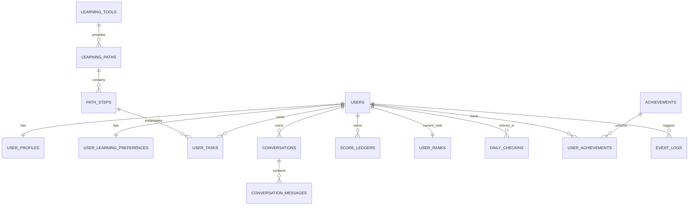

# AI编程学习教练 数据库 Schema 设计文档

> 文档类型：数据库 Schema 设计文档  
> 产品名称：AI编程学习教练  
> 版本：v1.0  
> 状态：初稿  
> 创建日期：2026-03-23  
> 适用阶段：MVP  
> 关联文档：`docs/plans/2026-03-23-ai-coding-tutor-technical-architecture.md`

---

## 1. 文档目标

本文档定义 AI编程学习教练 MVP 的关系型数据库设计，覆盖核心表结构、字段说明、约束、索引、枚举、关键查询场景和数据一致性规则，作为后续建表、迁移、接口开发和数据分析的依据。

数据库默认选型：

- `阿里云 AnalyticDB PostgreSQL 版 Supabase`

---

## 2. 设计原则

### 2.1 事务数据优先关系型建模

用户、路径、任务、会话、学分、成就之间关联明确，对一致性要求高，优先使用关系型表建模。

### 2.2 权威状态单点存储

任务状态、积分状态、当前主工具、当前段位等权威状态必须有明确归属，避免重复冗余造成漂移。

### 2.3 流水优先于覆盖

凡是需要审计、追踪、回溯和修复的状态变化，如积分发放、段位变更、任务完成，应优先保留流水。

### 2.4 模板与实例分离

学习路径模板和用户任务实例必须分离，便于：

- 路径复用
- 后续版本迭代
- 用户个性化派生

### 2.5 先支撑 MVP，再考虑扩展

首版不引入过多抽象层，但所有核心表保留必要扩展字段，如 `metadata`、`version`、`source_type`。

---

## 3. Schema 总览

建议按以下逻辑域组织数据库：

1. 认证与用户域
2. 学习路径与任务域
3. 对话与 AI 域
4. 成长与激励域
5. 分析与审计域

核心表：

- `auth.users`
- `public.user_profiles`
- `public.user_learning_preferences`
- `public.learning_tools`
- `public.learning_paths`
- `public.path_steps`
- `public.user_tasks`
- `public.conversations`
- `public.conversation_messages`
- `public.score_ledgers`
- `public.user_ranks`
- `public.daily_checkins`
- `public.achievements`
- `public.user_achievements`
- `public.event_logs`

---

## 4. ER 关系图

---

## 5. 枚举设计

建议使用 Postgres enum 或受控字符串。

## 5.1 `learning_level`

- `beginner`
- `intermediate`
- `advanced`

## 5.2 `task_status`

- `not_started`
- `in_progress`
- `blocked`
- `completed`
- `archived`

## 5.3 `conversation_status`

- `active`
- `completed`
- `abandoned`

## 5.4 `message_role`

- `user`
- `assistant`
- `system`

## 5.5 `message_content_type`

- `text`
- `link`
- `code`
- `system_feedback`

## 5.6 `score_event_type`

- `task_completed`
- `daily_checkin`
- `project_completed`
- `manual_adjustment`
- `achievement_reward`

## 5.7 `rank_code`

- `rookie`
- `apprentice`
- `vibe_coder`
- `builder`
- `master`

## 5.8 `event_source`

- `web`
- `api`
- `system`

---

## 6. 表结构设计

## 6.1 `user_profiles`

用途：

- 保存用户扩展档案与当前学习状态

主键：

- `user_id uuid`，引用 `auth.users.id`

字段建议：

| 字段 | 类型 | 约束 | 说明 |
|------|------|------|------|
| `user_id` | `uuid` | PK, FK | 用户主键 |
| `nickname` | `varchar(64)` | nullable | 昵称 |
| `avatar_url` | `text` | nullable | 头像 |
| `primary_tool_id` | `uuid` | FK, nullable | 当前主学习工具 |
| `learning_level` | `learning_level` | not null | 当前学习等级 |
| `current_rank_code` | `rank_code` | not null | 当前段位 |
| `current_score` | `integer` | not null default 0 | 当前积分快照 |
| `streak_days` | `integer` | not null default 0 | 连续学习天数 |
| `last_learning_at` | `timestamptz` | nullable | 最近学习时间 |
| `last_active_task_id` | `uuid` | nullable | 最近活跃任务 |
| `metadata` | `jsonb` | not null default '{}' | 扩展字段 |
| `created_at` | `timestamptz` | not null | 创建时间 |
| `updated_at` | `timestamptz` | not null | 更新时间 |

索引建议：

- `idx_user_profiles_primary_tool_id`
- `idx_user_profiles_learning_level`

## 6.2 `user_learning_preferences`

用途：

- 保存用户学习偏好与引导结果

字段建议：

| 字段 | 类型 | 约束 | 说明 |
|------|------|------|------|
| `id` | `uuid` | PK | 主键 |
| `user_id` | `uuid` | FK, unique | 用户 ID |
| `preferred_tool_ids` | `jsonb` | not null default '[]' | 偏好工具列表 |
| `onboarding_completed` | `boolean` | not null default false | 是否完成新手引导 |
| `goal_summary` | `text` | nullable | 学习目标摘要 |
| `content_language` | `varchar(16)` | not null default 'zh-CN' | 内容语言 |
| `metadata` | `jsonb` | not null default '{}' | 扩展字段 |
| `created_at` | `timestamptz` | not null | 创建时间 |
| `updated_at` | `timestamptz` | not null | 更新时间 |

## 6.3 `learning_tools`

用途：

- 工具字典表

字段建议：

| 字段 | 类型 | 约束 | 说明 |
|------|------|------|------|
| `id` | `uuid` | PK | 主键 |
| `code` | `varchar(64)` | unique | 工具代码，如 `cursor` |
| `name` | `varchar(64)` | not null | 工具名称 |
| `tool_type` | `varchar(32)` | not null | `gui` / `cli` / `lightweight` |
| `difficulty_level` | `learning_level` | not null | 推荐适用等级 |
| `is_active` | `boolean` | not null default true | 是否启用 |
| `sort_order` | `integer` | not null default 0 | 排序 |
| `metadata` | `jsonb` | not null default '{}' | 描述、推荐文案等 |
| `created_at` | `timestamptz` | not null | 创建时间 |
| `updated_at` | `timestamptz` | not null | 更新时间 |

索引建议：

- `uidx_learning_tools_code`
- `idx_learning_tools_tool_type_sort_order`

## 6.4 `learning_paths`

用途：

- 学习路径模板

字段建议：

| 字段 | 类型 | 约束 | 说明 |
|------|------|------|------|
| `id` | `uuid` | PK | 主键 |
| `tool_id` | `uuid` | FK | 对应工具 |
| `code` | `varchar(64)` | unique | 路径代码 |
| `name` | `varchar(128)` | not null | 路径名称 |
| `target_level` | `learning_level` | not null | 适用等级 |
| `version` | `integer` | not null default 1 | 模板版本 |
| `is_default` | `boolean` | not null default false | 是否默认路径 |
| `is_active` | `boolean` | not null default true | 是否启用 |
| `description` | `text` | nullable | 路径说明 |
| `metadata` | `jsonb` | not null default '{}' | 扩展信息 |
| `created_at` | `timestamptz` | not null | 创建时间 |
| `updated_at` | `timestamptz` | not null | 更新时间 |

索引建议：

- `idx_learning_paths_tool_level`
- `idx_learning_paths_code`

## 6.5 `path_steps`

用途：

- 学习路径中的步骤模板

字段建议：

| 字段 | 类型 | 约束 | 说明 |
|------|------|------|------|
| `id` | `uuid` | PK | 主键 |
| `path_id` | `uuid` | FK | 路径 ID |
| `step_no` | `integer` | not null | 第几步 |
| `title` | `varchar(128)` | not null | 步骤标题 |
| `goal` | `text` | not null | 学习目标 |
| `completion_criteria` | `text` | nullable | 完成标准 |
| `knowledge_points` | `jsonb` | not null default '[]' | 知识点标签 |
| `difficulty_weight` | `integer` | not null default 1 | 难度权重 |
| `is_required` | `boolean` | not null default true | 是否必做 |
| `metadata` | `jsonb` | not null default '{}' | 下一步预告、示例提示等 |
| `created_at` | `timestamptz` | not null | 创建时间 |
| `updated_at` | `timestamptz` | not null | 更新时间 |

约束建议：

- `unique(path_id, step_no)`

索引建议：

- `idx_path_steps_path_id_step_no`

## 6.6 `user_tasks`

用途：

- 用户维度的任务实例表

字段建议：

| 字段 | 类型 | 约束 | 说明 |
|------|------|------|------|
| `id` | `uuid` | PK | 主键 |
| `user_id` | `uuid` | FK | 用户 ID |
| `path_id` | `uuid` | FK | 来源路径 |
| `path_step_id` | `uuid` | FK | 来源步骤 |
| `status` | `task_status` | not null | 任务状态 |
| `started_at` | `timestamptz` | nullable | 开始时间 |
| `completed_at` | `timestamptz` | nullable | 完成时间 |
| `blocked_at` | `timestamptz` | nullable | 卡住时间 |
| `block_reason` | `text` | nullable | 卡点描述 |
| `attempt_count` | `integer` | not null default 0 | 尝试次数 |
| `last_conversation_id` | `uuid` | nullable | 最近关联会话 |
| `score_awarded` | `integer` | not null default 0 | 此任务已奖励积分 |
| `metadata` | `jsonb` | not null default '{}' | 扩展字段 |
| `created_at` | `timestamptz` | not null | 创建时间 |
| `updated_at` | `timestamptz` | not null | 更新时间 |

约束建议：

- `unique(user_id, path_step_id)` 用于同一路径模板下避免重复实例

索引建议：

- `idx_user_tasks_user_status`
- `idx_user_tasks_user_path`
- `idx_user_tasks_last_conversation_id`

## 6.7 `conversations`

用途：

- 学习会话容器

字段建议：

| 字段 | 类型 | 约束 | 说明 |
|------|------|------|------|
| `id` | `uuid` | PK | 主键 |
| `user_id` | `uuid` | FK | 用户 ID |
| `task_id` | `uuid` | FK, nullable | 关联任务 |
| `tool_id` | `uuid` | FK, nullable | 当前工具 |
| `status` | `conversation_status` | not null default 'active' | 会话状态 |
| `summary` | `text` | nullable | 最近摘要 |
| `last_message_at` | `timestamptz` | nullable | 最近消息时间 |
| `resume_token` | `varchar(128)` | nullable | 恢复标记 |
| `metadata` | `jsonb` | not null default '{}' | 扩展字段 |
| `created_at` | `timestamptz` | not null | 创建时间 |
| `updated_at` | `timestamptz` | not null | 更新时间 |

索引建议：

- `idx_conversations_user_last_message_at`
- `idx_conversations_task_id`

## 6.8 `conversation_messages`

用途：

- 会话中的消息明细

字段建议：

| 字段 | 类型 | 约束 | 说明 |
|------|------|------|------|
| `id` | `uuid` | PK | 主键 |
| `conversation_id` | `uuid` | FK | 会话 ID |
| `task_id` | `uuid` | FK, nullable | 关联任务 |
| `role` | `message_role` | not null | 消息角色 |
| `content_type` | `message_content_type` | not null default 'text' | 内容类型 |
| `content_text` | `text` | nullable | 文本内容 |
| `structured_payload` | `jsonb` | not null default '{}' | 结构化 AI 输出 |
| `source_input` | `jsonb` | not null default '{}' | 原始输入信息 |
| `sequence_no` | `integer` | not null | 会话内顺序 |
| `model_name` | `varchar(64)` | nullable | 使用模型 |
| `latency_ms` | `integer` | nullable | 响应耗时 |
| `created_at` | `timestamptz` | not null | 创建时间 |

约束建议：

- `unique(conversation_id, sequence_no)`

索引建议：

- `idx_conversation_messages_conversation_sequence`
- `idx_conversation_messages_task_id`

## 6.9 `score_ledgers`

用途：

- 积分流水表

字段建议：

| 字段 | 类型 | 约束 | 说明 |
|------|------|------|------|
| `id` | `uuid` | PK | 主键 |
| `user_id` | `uuid` | FK | 用户 ID |
| `task_id` | `uuid` | FK, nullable | 任务来源 |
| `event_type` | `score_event_type` | not null | 积分类型 |
| `score_delta` | `integer` | not null | 积分增量 |
| `idempotency_key` | `varchar(128)` | unique | 幂等键 |
| `source_ref` | `varchar(128)` | nullable | 来源标识 |
| `remark` | `text` | nullable | 备注 |
| `created_at` | `timestamptz` | not null | 创建时间 |

索引建议：

- `idx_score_ledgers_user_created_at`
- `uidx_score_ledgers_idempotency_key`

## 6.10 `user_ranks`

用途：

- 用户当前段位快照

字段建议：

| 字段 | 类型 | 约束 | 说明 |
|------|------|------|------|
| `user_id` | `uuid` | PK, FK | 用户 ID |
| `rank_code` | `rank_code` | not null | 当前段位 |
| `score_snapshot` | `integer` | not null | 当前积分快照 |
| `next_rank_code` | `rank_code` | nullable | 下一段位 |
| `score_to_next_rank` | `integer` | nullable | 距离下一段位积分 |
| `updated_at` | `timestamptz` | not null | 更新时间 |

## 6.11 `daily_checkins`

用途：

- 每日打卡记录

字段建议：

| 字段 | 类型 | 约束 | 说明 |
|------|------|------|------|
| `id` | `uuid` | PK | 主键 |
| `user_id` | `uuid` | FK | 用户 ID |
| `checkin_date` | `date` | not null | 打卡日期 |
| `score_awarded` | `integer` | not null default 0 | 奖励积分 |
| `idempotency_key` | `varchar(128)` | unique | 幂等键 |
| `created_at` | `timestamptz` | not null | 创建时间 |

约束建议：

- `unique(user_id, checkin_date)`

索引建议：

- `idx_daily_checkins_user_date`

## 6.12 `achievements`

用途：

- 成就定义表

字段建议：

| 字段 | 类型 | 约束 | 说明 |
|------|------|------|------|
| `id` | `uuid` | PK | 主键 |
| `code` | `varchar(64)` | unique | 成就代码 |
| `name` | `varchar(128)` | not null | 成就名称 |
| `description` | `text` | nullable | 成就描述 |
| `trigger_rule` | `jsonb` | not null | 达成规则 |
| `reward_score` | `integer` | not null default 0 | 成就奖励 |
| `is_active` | `boolean` | not null default true | 是否启用 |
| `created_at` | `timestamptz` | not null | 创建时间 |
| `updated_at` | `timestamptz` | not null | 更新时间 |

## 6.13 `user_achievements`

用途：

- 用户成就达成记录

字段建议：

| 字段 | 类型 | 约束 | 说明 |
|------|------|------|------|
| `id` | `uuid` | PK | 主键 |
| `user_id` | `uuid` | FK | 用户 ID |
| `achievement_id` | `uuid` | FK | 成就 ID |
| `unlocked_at` | `timestamptz` | not null | 解锁时间 |
| `source_ref` | `varchar(128)` | nullable | 来源任务或事件 |
| `metadata` | `jsonb` | not null default '{}' | 扩展字段 |

约束建议：

- `unique(user_id, achievement_id)`

## 6.14 `event_logs`

用途：

- 产品关键事件日志表

字段建议：

| 字段 | 类型 | 约束 | 说明 |
|------|------|------|------|
| `id` | `uuid` | PK | 主键 |
| `user_id` | `uuid` | FK, nullable | 用户 ID |
| `event_name` | `varchar(128)` | not null | 事件名 |
| `event_source` | `event_source` | not null default 'web' | 事件来源 |
| `page_path` | `varchar(256)` | nullable | 页面路径 |
| `properties` | `jsonb` | not null default '{}' | 事件属性 |
| `occurred_at` | `timestamptz` | not null | 发生时间 |
| `created_at` | `timestamptz` | not null | 入库时间 |

索引建议：

- `idx_event_logs_event_name_occurred_at`
- `idx_event_logs_user_id_occurred_at`

---

## 7. 关键约束与一致性规则

## 7.1 任务唯一性

- 同一用户对同一路径步骤只允许存在一个有效 `user_tasks`
- 如需支持路径重学，建议未来增加 `attempt_group_id`

## 7.2 积分幂等

- 所有积分发放必须携带 `idempotency_key`
- 完成任务、打卡、成就奖励均通过幂等键防止重复发放

## 7.3 段位快照更新

- `user_profiles.current_score`
- `user_profiles.current_rank_code`
- `user_ranks`

以上字段更新必须由同一事务完成。

## 7.4 会话顺序一致性

- 会话消息顺序以 `sequence_no` 保证
- 前端不得自行计算权威顺序

## 7.5 打卡唯一性

- 每个用户每天最多一条打卡记录
- 使用 `unique(user_id, checkin_date)` 保障

---

## 8. 索引策略

重点优化以下查询：

1. 查询用户当前学习状态
2. 查询最近会话与历史记录
3. 查询某工具默认路径和步骤
4. 查询任务列表与地图
5. 查询成就与积分流水

建议重点索引：

- `user_tasks(user_id, status, updated_at desc)`
- `conversations(user_id, last_message_at desc)`
- `conversation_messages(conversation_id, sequence_no)`
- `score_ledgers(user_id, created_at desc)`
- `daily_checkins(user_id, checkin_date desc)`
- `event_logs(event_name, occurred_at desc)`

---

## 9. 典型查询场景

## 9.1 获取学习主界面上下文

需要查询：

- `user_profiles`
- 当前 `user_tasks`
- 最近 `conversations`
- 最近若干条 `conversation_messages`
- `user_ranks`

## 9.2 获取闯关地图

需要查询：

- `learning_paths`
- `path_steps`
- 用户对应的 `user_tasks`

## 9.3 获取成就中心

需要查询：

- `user_profiles`
- `user_ranks`
- `score_ledgers`
- `user_achievements`

## 9.4 记录任务完成

需要写入：

- `user_tasks`
- `score_ledgers`
- `user_profiles`
- `user_ranks`
- 可选 `event_logs`

必须在事务内完成。

---

## 10. RLS 与权限建议

若使用阿里云 Supabase 提供的 Row Level Security，建议如下：

### 用户级表开启 RLS

- `user_profiles`
- `user_learning_preferences`
- `user_tasks`
- `conversations`
- `conversation_messages`
- `score_ledgers`
- `user_ranks`
- `daily_checkins`
- `user_achievements`
- `event_logs`

### 策略原则

- 用户只能读取自己的记录
- 业务写入优先走服务端 Role，而不是完全暴露客户端写权限
- 字典表如 `learning_tools`、`learning_paths`、`achievements` 可开放只读

---

## 11. 迁移与版本管理建议

### 11.1 迁移策略

- 所有建表、索引、约束统一走 migration
- 禁止在生产环境手工改表

### 11.2 版本策略

- 路径模板支持 `version`
- 如未来路径逻辑变化，不直接覆写已发放给用户的实例

### 11.3 软删除策略

MVP 阶段建议谨慎使用软删除：

- 字典表可用 `is_active`
- 用户任务和积分流水不建议物理删除

---

## 12. 数据保留与隐私

- 会话消息与代码片段属于敏感数据，应控制日志暴露范围
- `conversation_messages.content_text` 不应进入公开监控系统
- 必要时对原始输入进行脱敏
- 用户删除账号时需预留级联清理或匿名化策略

---

## 13. 建表顺序建议

建议按以下顺序落表：

1. `learning_tools`
2. `learning_paths`
3. `path_steps`
4. `user_profiles`
5. `user_learning_preferences`
6. `user_ranks`
7. `user_tasks`
8. `conversations`
9. `conversation_messages`
10. `score_ledgers`
11. `daily_checkins`
12. `achievements`
13. `user_achievements`
14. `event_logs`

---

## 14. 结论

这套 Schema 的核心目标，是保证学习闭环中的三个关键对象始终清晰可控：

- 用户当前状态
- 用户当前任务
- 用户当前成长结果

只要这三个对象的建模、流水和约束设计稳定，MVP 的 AI 导师、任务推进和激励系统就能保持一致性，并为后续支付、社区、推荐和多模态扩展打下基础。
