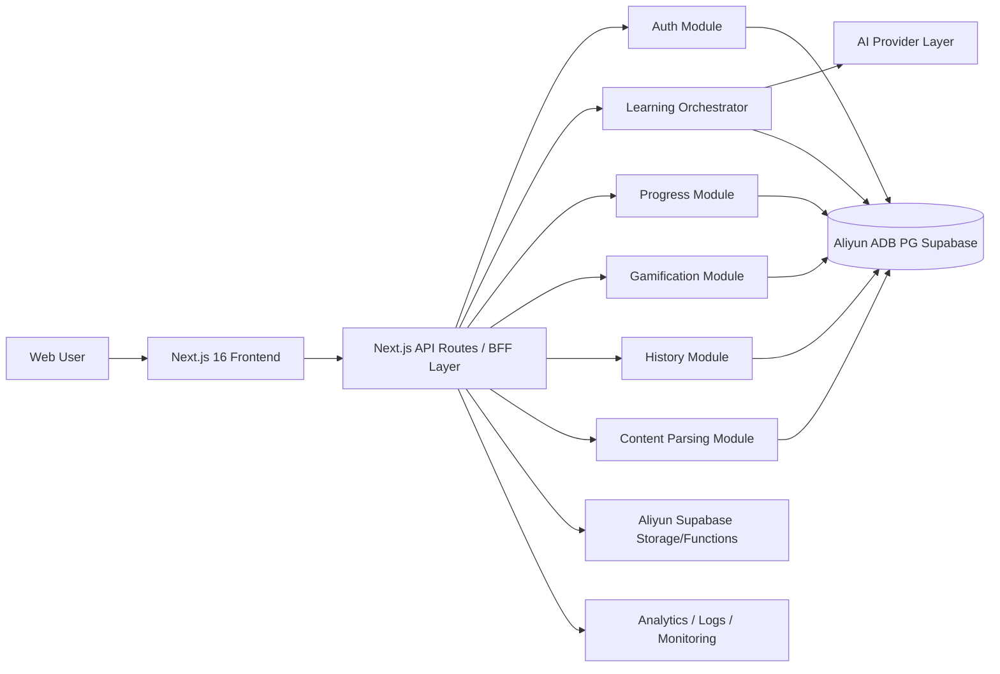
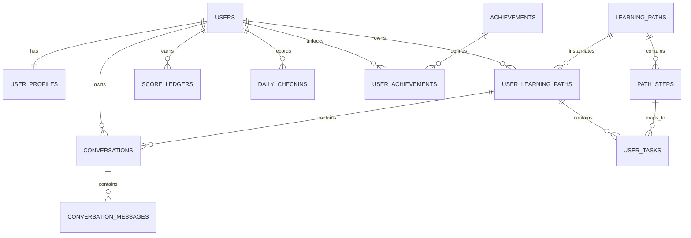
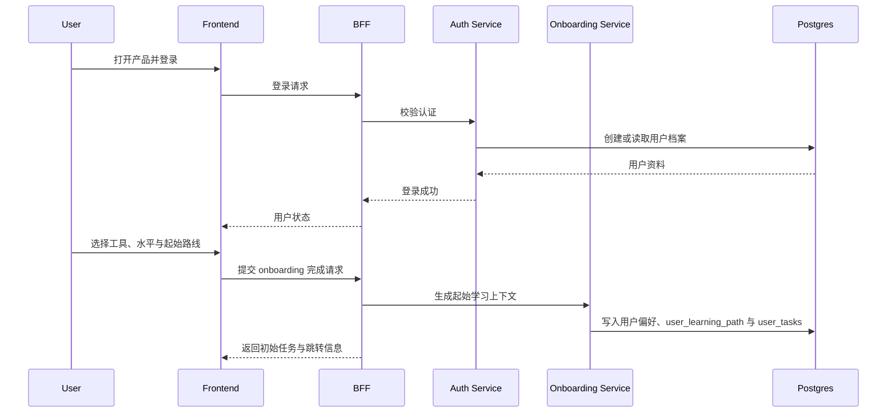
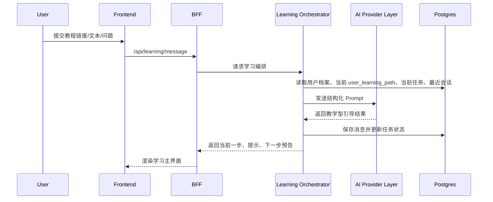
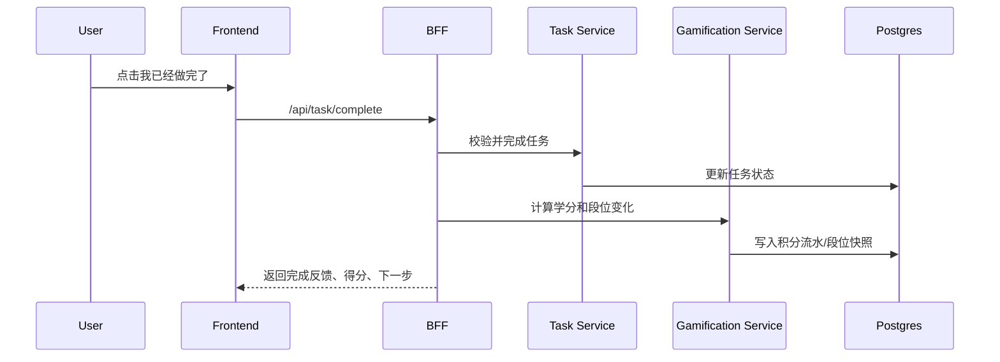
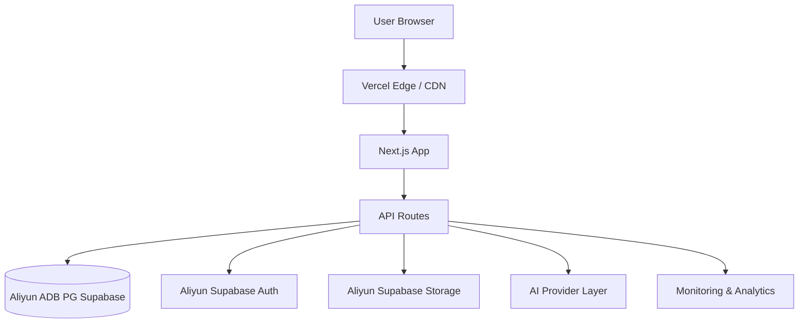

# AI编程学习教练 技术架构设计文档

> 文档类型：技术架构设计文档  
> 产品名称：AI编程学习教练  
> 版本：v1.1  
> 状态：已按当前代码实现同步  
> 创建日期：2026-03-23  
> 适用阶段：MVP  
> 关联文档：`docs/plans/2026-03-23-ai-coding-tutor-prd.md`、`docs/plans/2026-03-23-ai-coding-tutor-api-spec.md`

---

## 1. 文档目标

本文档用于定义 AI编程学习教练 MVP 的整体技术架构、核心技术决策、模块边界、数据模型、关键链路、部署方案和演进路径，作为研发、测试、运维和后续架构评审的统一依据。

本文档重点回答以下问题：

- 系统整体采用什么架构形态
- 为什么当前阶段这样设计
- 前端、后端、数据和 AI 能力如何协作
- 关键业务链路如何落地
- MVP 阶段的风险点、扩展点和演进路径是什么

### 1.1 当前原型校准说明

当前仓库已经不是纯文档状态，而是包含真实前端原型的同仓项目。技术架构判断需要以当前真实页面和数据语义为准。

当前前端已存在的核心页面：

- `/`
- `/login`
- `/onboarding`
- `/learn`
- `/map`
- `/achievements`
- `/history`

本次架构校准的核心约束：

- 产品主线应围绕 `user_learning_paths` 展开，而不是围绕“最近会话列表”展开。
- `/map`、`/learn`、`/history` 共享同一条学习路径实例主线。
- `/history` 页当前承载的是“历史学习计划列表”，不是“最近消息列表”。
- FAQ、订阅展示块、营销定价文案仍属于前端静态表达，不属于首期后端权威域模型。

### 1.2 当前实现快照

截至当前代码，项目已落地为“Next.js 前端 + `app/api` BFF + `server/modules` 服务层 + Supabase” 的同仓全栈形态，而不是仅有原型页面。

当前已打通的关键链路包括：

- Supabase Auth 登录态接入，支持手机号验证码登录与微信 OAuth 跳转
- 首页营销层可通过 `GET /api/auth/session` 恢复登录态，并将主要 CTA 切换为“继续学习”，按真实状态跳转到 `/learn`、`/history` 或 `/onboarding`
- onboarding 读取工具和路径候选，并真实创建 `user_learning_paths` 与 `user_tasks`
- `/learn`、`/map`、`/achievements`、`/history` 读取远程数据库的真实 read model
- `POST /api/task/complete`、`POST /api/task/update-status`、`POST /api/checkin/daily` 已落地，任务推进、XP/段位写模型与每日打卡已接通
- 历史学习计划已支持详情复盘、放弃、重新激活与软删除，学习计划状态机已扩展到 `active/interrupted/completed/abandoned/archived`
- 工作台左侧栏数据已提升到根级 Provider 缓存，跨工作台页面切换时不再重复请求并产生加载跳动
- 用户资料读写、头像上传到 Supabase Storage
- 用户反馈提交、我的反馈记录、管理员反馈接口
- `POST /api/learning/message`、`GET /api/learning/messages` 已接入真实 AI 编排链路，包含会话持久化、历史分页、SiliconFlow provider、JSON / SSE 双返回、结构化 `structuredContent` 与 `task_patch` 联动

当前尚未落地的链路包括：

- 事件埋点写接口
- 管理员后台前端
- 通知设置落库
- Redis / 队列等增强型基础设施

---

## 2. 背景与约束

### 2.1 产品背景

AI编程学习教练的核心能力不是内容分发，而是将教程、链接、代码片段和学习问题转化为可执行学习路径，并通过 AI 导师、任务拆解、进度记录和成长反馈提升用户学习完成率与留存。

### 2.2 MVP 业务边界

MVP 目标范围：

- 用户账号系统
- 工具选择、水平分层与起始训练路线选择
- AI 导师对话
- 学习任务拆解与状态推进
- 学习进度追踪
- 基础学分与段位系统
- 闯关地图、成就页与历史学习页
- 核心埋点与数据分析

当前仍未纳入或尚未实现范围：

- 排行榜与社区
- 支付系统
- 企业协作
- 移动端 App
- 多模态截图解析

### 2.3 技术约束

- 前后端技术栈已在产品设计阶段初步约束为 `Next.js 16 + React 19.2 + TypeScript 5.9 + Tailwind CSS 4 + 阿里云 AnalyticDB PostgreSQL 版 Supabase + 外部 AI provider 抽象层 + Vercel`
- 首版以快速验证产品闭环为目标，不追求过早分布式拆分
- 需要尽量降低运维复杂度，优先采用托管服务
- 需要支持中文市场的账号体系与未来支付接入预留
- 运行时基线建议为 `Node.js 24 Active LTS`

---

## 3. 架构目标

### 3.1 核心目标

1. 以尽可能低的复杂度支撑 MVP 快速上线和迭代。
2. 保证核心学习闭环稳定可用：登录 -> 完成新手引导 -> 发起学习 -> 获得下一步 -> 完成任务 -> 记录成长。
3. 让 AI 能力、任务状态和用户成长数据具备一致性。
4. 为后续支付、社区、更多工具路径和多模态输入预留扩展空间。

### 3.2 非目标

当前架构不以以下目标为优先：

- 超大规模分布式服务治理
- 多区域多活
- 企业级复杂权限体系
- 独立推荐系统
- 自建模型服务平台

---

## 4. 架构原则

### 4.1 优先模块化单体，不做过早微服务

MVP 阶段采用模块化单体架构，而不是微服务架构。原因如下：

- 当前团队规模和产品复杂度尚不足以支撑微服务收益
- 学习路径、对话、积分、成就等模块耦合紧密
- 微服务会显著增加发布、调试、测试和观测成本
- 现阶段最重要的是验证业务闭环，而不是优化组织边界

### 4.2 托管优先

优先使用托管能力：

- Vercel：部署与边缘分发
- 阿里云 AnalyticDB PostgreSQL 版 Supabase：Postgres、认证、边缘函数与托管后台能力
- 外部 AI provider 抽象层：模型推理，当前首版已接入 SiliconFlow，并保留多 provider 扩展边界

### 4.3 AI 是业务引擎的一部分，不是孤立外挂

AI 输出不能只作为一段聊天回复存在，而必须与以下结构绑定：

- 当前用户
- 当前工具与当前学习路径实例
- 当前任务状态
- 最近会话上下文
- 成长系统结果

对于平台预设训练路径，AI 还必须绑定：

- 当前训练路径模板
- 当前路径所绑定的训练 agent
- 当前关卡所属路径实例位置

### 4.4 事件可观测优先

学习产品的核心价值依赖行为分析，因此关键动作必须被埋点、可追踪、可回溯。

### 4.5 为未来演进保留边界

虽然当前采用单体，但内部代码与数据模型应按领域清晰分层，以支持未来按域拆分服务。

---

## 5. 架构决策摘要

| 决策项 | 方案 | 理由 |
|------|------|------|
| 应用架构 | 模块化单体 | MVP 交付快、复杂度低、迭代效率高 |
| Web 架构 | Next.js 16 全栈一体 | 前后端同仓协作效率高，适合 MVP |
| 前端运行时与框架 | React 19.2 + TypeScript 5.9 + Tailwind CSS 4 | 与 Next.js 16 对齐，采用当前稳定代际 |
| 数据库 | 阿里云 AnalyticDB PostgreSQL 版 Supabase | 延续 Supabase 范式，同时更贴近国内微信生态接入诉求 |
| 认证 | 阿里云 Supabase Auth | 保留 Supabase Auth 范式，并优先使用其国内 OAuth 能力 |
| AI 服务 | 外部 AI provider 抽象层（首期 SiliconFlow） | 当前已接通首版真实 provider，并通过抽象层保留多 provider / 多模型扩展能力 |
| 状态管理 | 服务端主状态 + 前端轻状态 | 核心状态统一在服务端，避免任务状态漂移 |
| 部署 | Vercel + 托管数据库 | 降低运维门槛 |
| 观测 | 事件埋点 + 服务日志 + 前端错误监控 | 支撑产品验证与快速定位问题 |

---

## 6. 总体架构

### 6.1 架构概览

### 6.2 分层说明

系统分为 5 层：

1. 表现层：Next.js 页面、组件、交互状态
2. BFF 层：API Routes，负责聚合前端所需接口
3. 领域服务层：认证、学习编排、任务状态、积分段位、内容解析
4. 数据层：阿里云 Supabase Postgres、Storage/Functions、埋点数据
5. 外部能力层：AI Provider Layer、消息/支付等未来外部服务

---

## 7. 逻辑模块设计

## 7.1 前端模块

建议前端按以下业务模块组织：

- `marketing`
- `auth`
- `onboarding`
- `learning`
- `progress`
- `achievement`
- `history`
- `shared-ui`
- `analytics`

### 前端职责

- 提供页面和交互体验
- 管理临时 UI 状态
- 调用 BFF 接口
- 渲染服务端返回的任务、对话、学分和状态
- 触发关键事件埋点

### 前端不负责

- 直接定义任务状态机
- 直接计算学分与段位
- 在客户端保存权威业务状态

## 7.2 BFF 层

采用 Next.js API Routes 作为 BFF 层。

职责：

- 统一前端调用入口
- 处理鉴权和参数校验
- 聚合多个服务返回
- 屏蔽数据库结构细节
- 封装 AI 调用和领域服务编排

建议接口分组：

- `/api/auth/*`
- `/api/profile/*`
- `/api/onboarding/*`
- `/api/learning/*`
- `/api/task/*`
- `/api/progress/*`
- `/api/achievement/*`
- `/api/history/*`
- `/api/analytics/*`

## 7.3 领域服务模块

建议在服务端拆出以下逻辑模块：

### Auth Service

- 登录状态校验
- 用户档案初始化
- 权限校验

### Onboarding Service

- 用户等级分层
- 主工具选择
- 起始路线候选生成
- 平台预设训练路径与训练 agent 匹配
- 首次学习上下文初始化

### Learning Orchestrator

- 接收用户输入
- 获取上下文
- 组织 Prompt
- 调用模型
- 解析结构化结果
- 更新会话和任务状态

### Task Service

- 管理任务状态机
- 更新任务进度
- 校验任务完成
- 生成下一步任务

### Gamification Service

- 学分计算
- 段位计算
- 打卡逻辑
- 成就达成

### History Service

- 历史学习计划分页列表
- 路径实例摘要聚合
- 与当前学习路径实例的衔接

### Analytics Service

- 关键事件采集
- 指标聚合支持

---

## 8. 数据架构设计

## 8.1 数据库选型结论

MVP 阶段采用 `阿里云 AnalyticDB PostgreSQL 版 Supabase` 作为主数据库与认证底座。

原因：

- 用户、学习路径、任务、消息、成长数据关系明确，天然适合关系型建模
- 任务状态、学分流水、成就规则对一致性要求较高
- 阿里云托管 Supabase 在保留 Supabase 范式的同时，更适合国内账号接入场景
- 未来如果需要搜索、缓存、向量等能力，可增量引入，不影响主事务库

## 8.2 核心实体

建议核心表至少包括：

- `users`
- `user_profiles`
- `user_learning_preferences`
- `learning_tools`
- `learning_paths`
- `path_steps`
- `user_learning_paths`
- `user_tasks`
- `conversation_sessions`
- `conversation_messages`
- `score_ledgers`
- `user_ranks`
- `daily_checkins`
- `achievements`
- `user_achievements`
- `event_logs`

## 8.3 数据关系概览

## 8.4 关键建模说明

### 用户与档案

- `users` 保存认证主键和最基础身份信息
- `user_profiles` 保存昵称、主工具、当前等级、当前段位等扩展信息

### 路径与任务

- `learning_paths` 是路径模板，既可承载平台预设训练，也可承载自学模式生成出的轻量路径壳
- `path_steps` 是路径模板中的具体步骤
- `user_learning_paths` 是用户维度的学习路径实例，承接 `/learn`、`/map`、`/history` 的共同主线
- `user_tasks` 是用户维度的任务实例，存储状态、开始时间、完成时间、是否卡住等信息

### 会话与消息

- `conversation_sessions` 记录用户一次学习会话的容器，并归属于某条 `user_learning_path`
- `conversation_messages` 记录具体消息，需区分 `user` / `assistant` / `system`

### 学分与段位

- `score_ledgers` 使用流水而不是直接覆盖字段，便于追溯和修复
- `user_ranks` 可保存当前段位快照，也可由积分区间推导

### 埋点与分析

- `event_logs` 存储核心业务事件，必要时异步导出到分析系统

---

## 9. 关键业务流程设计

## 9.1 首次使用流程

## 9.2 规划中的 AI 导师学习流程

## 9.3 当前已打通的任务完成与成长反馈流程

## 9.4 历史恢复流程

- 用户进入学习主界面
- 前端请求最近学习状态
- 服务端读取当前 `user_learning_path`、当前任务、最近会话、右侧面板上下文
- 前端恢复到对应路径与对话位置

## 9.5 历史学习页流程

- 用户进入 `/history`
- 前端请求历史学习计划列表
- 服务端先基于 `last_activity_at` 对 `active` 计划执行“7 天自动中断”对账
- 服务端基于 `user_learning_paths` 聚合工具、模式、进度、XP、时间线与状态摘要
- 前端渲染进行中、已中断、已完成、已放弃四类计划卡片
- 用户可继续当前计划、重新激活中断计划、放弃进行中计划、查看复盘详情或删除历史记录

---

## 10. AI 编排架构（规划中）

本节只保留总体架构摘要。字段级表结构、agent 绑定、skill 机制、provider 选择与首批路径命中规则，以 [AI Orchestration 设计文档](/Users/baoyouhua/Documents/CodeTutor/docs/plans/2026-03-30-ai-coding-tutor-ai-orchestration-design.md) 为准。

## 10.1 设计目标

AI 能力必须稳定输出教学型结构，而不是自由散漫的聊天回复。

## 10.2 输入上下文组成

每次学习请求建议至少包含以下上下文：

- 用户等级
- 主学习工具
- 当前路径与任务
- 最近 N 条有效对话
- 当前输入内容
- 产品输出约束

## 10.3 输出结构约束

建议模型输出使用结构化 JSON，再由服务端转换成页面可用内容。

建议结构：

- `current_goal`
- `current_step`
- `why_this_step`
- `hint_if_stuck`
- `knowledge_points`
- `next_step_preview`
- `task_state_update`

## 10.4 Prompt 分层

建议分三层 Prompt：

1. System Prompt：定义 AI 导师角色和总原则
2. Policy Prompt：约束不要直接代做、必须给下一步、必须考虑用户等级
3. Runtime Prompt：注入当前任务、上下文、输入内容

## 10.5 稳定性策略

- 设置统一输出模版
- 对 AI 结果做服务端 schema 校验
- 失败时回退到保守兜底文案
- 记录失败样本用于后续 prompt 调优

---

## 11. API 设计说明

## 11.1 核心 API 列表

### 认证与档案

当前已实现：

- `POST /api/auth/login`
- `GET /api/auth/session`
- `GET /api/profile/me`
- `PATCH /api/profile/me`
- `POST /api/profile/avatar`

规划中：

- `POST /api/profile/init`

### 新手引导

- `GET /api/onboarding/tools`
- `GET /api/onboarding/path-options`
- `POST /api/onboarding/complete`

### 学习核心

当前已实现：

- `POST /api/learning/message`
- `GET /api/learning/current-session`

规划中：

- `POST /api/learning/stuck-help`

### 任务与进度

当前已实现：

- `POST /api/task/complete`
- `POST /api/task/update-status`
- `GET /api/progress/current`
- `GET /api/progress/map`

### 成长与历史

当前已实现：

- `GET /api/achievement/summary`
- `GET /api/history/recent`
- `GET /api/history/{id}`
- `POST /api/history/{id}/status`
- `POST /api/checkin/daily`

### 反馈与运营

当前已实现：

- `POST /api/feedback`
- `GET /api/feedback/mine`
- `GET /api/feedback/mine/{id}`
- `GET /api/admin/feedback`
- `GET /api/admin/feedback/{id}`
- `POST /api/admin/feedback/{id}/reply`
- `POST /api/admin/feedback/{id}/status`

### 数据与事件

规划中：

- `POST /api/analytics/event`

## 11.2 API 规范

- 所有接口统一返回 `code / message / data`
- 错误码分类为：认证错误、参数错误、业务错误、外部服务错误、系统错误
- 关键业务接口要求幂等，尤其是任务完成、打卡、积分发放

---

## 12. 前端架构建议

## 12.1 路由划分

建议页面路由至少包括：

- `/`
- `/login`
- `/onboarding`
- `/learn`
- `/map`
- `/achievements`
- `/history`

## 12.2 状态管理策略

前端只保存以下状态：

- 当前页面 UI 状态
- 输入框内容
- 浮层开关
- 局部页面请求结果缓存
- 工作台左侧栏共享缓存（根级 Provider）

服务端权威状态包括：

- 用户档案
- 当前学习路径实例
- 当前任务状态
- 会话记录
- 积分与段位
- 打卡结果

## 12.3 组件层级建议

- `app-shell`
- `domain components`
- `shared-ui`
- `hooks`
- `lib/api`

---

## 13. 安全与隐私设计

## 13.1 认证与权限

- 所有学习数据接口必须校验用户身份
- 用户只能访问自己的会话、任务和成长数据
- 接口鉴权在 BFF 层统一处理

## 13.2 密钥管理

- AI provider API Key、阿里云 Supabase Service Key 等只存于服务端环境变量
- 前端绝不直连模型密钥

## 13.3 数据保护

- 用户提交的教程链接、代码片段和会话记录需明确用途
- 对敏感输入场景进行日志脱敏
- 避免将用户完整代码内容写入公开日志

## 13.4 风险点

### 平台接入确认风险

当前已完成远程数据库连通、短信 OTP 登录、头像 Storage 上传与基础 OAuth callback 接入，但仍需继续验证微信 OAuth 在真实生产域名、不同环境隔离和异常回调场景下的稳定性。

### AI 输出不可控

需要通过 schema 校验、兜底策略和失败追踪降低风险。

### 积分重复发放

必须通过幂等键和事务性更新避免重复记分。

---

## 14. 性能与扩展性设计

## 14.1 MVP 性能目标

- 页面骨架快速可用
- 学习主界面恢复速度可接受
- AI 请求具备明确加载反馈
- 常用查询响应应通过索引与聚合优化保持稳定

## 14.2 性能优化策略

- 关键页面采用服务端渲染或混合渲染
- 历史记录、地图、成就等接口进行分页或聚合
- 对高频读取的用户当前状态做适度缓存
- 避免每次消息都全量加载完整历史

## 14.3 未来扩展点

后续如果出现以下情况，可以考虑架构拆分：

- 日活和消息量显著增长
- 需要异步任务队列处理复杂解析
- 多模型、多供应商编排复杂度上升
- 事件分析规模超出事务库承受范围

可演进方向：

- 引入消息队列处理异步任务
- 将 Analytics 拆到独立分析链路
- 将 AI 编排模块独立为服务
- 引入 Redis 做会话缓存与频控

---

## 15. 可观测性设计

## 15.1 需要监控的关键指标

- 登录成功率
- 工具选择完成率
- 学习消息发送成功率
- AI 调用成功率与耗时
- 任务完成率
- 打卡成功率
- 前端错误率

## 15.2 日志策略

服务端日志至少包含：

- request_id
- user_id
- endpoint
- task_id
- ai_call_id
- latency
- result_code

## 15.3 埋点事件

与产品指标对齐的关键事件：

- `signup_completed`
- `tool_selected`
- `first_session_started`
- `task_generated`
- `task_completed`
- `stuck_help_requested`
- `daily_checkin_completed`
- `rank_up`
- `session_resumed`

---

## 16. 部署架构

## 16.1 部署拓扑

## 16.2 环境划分

建议至少分为：

- `local`
- `preview`
- `staging`
- `production`

## 16.3 发布策略

- 每次合并主分支自动生成 preview 环境
- staging 用于内测和回归
- production 控制发布窗口与关键配置

---

## 17. 演进路线

## 阶段一：MVP

- 模块化单体
- 托管数据库
- 单模型供应商
- 事务库承载核心事件

## 阶段二：增长期

- 引入缓存层
- 分离分析数据链路
- 加强异步任务处理
- 支持更多工具路径与更多模型策略

## 阶段三：平台化

- AI 编排服务独立
- 成长系统与路径系统模块化强化
- 接入支付、社区、企业能力

---

## 18. 主要技术风险与应对

| 风险 | 说明 | 应对策略 |
|------|------|------|
| 阿里云 Supabase 能力边界与预期不一致 | 文档支持与实际控制台能力可能存在差异 | 第一周优先做产品能力验证，确认微信 OAuth、Auth 流程和环境隔离 |
| AI 输出不稳定 | 模型可能偏离教学型输出格式 | 结构化输出 + schema 校验 + fallback |
| 任务状态不一致 | 会话与任务状态更新可能出现漂移 | 任务状态机统一在服务端，关键写操作走事务 |
| 积分重复发放 | 完成任务、打卡等高频行为易重复记分 | 幂等键、唯一约束、流水表 |
| 数据分析口径不稳 | 埋点与业务状态不一致 | 先定义事件字典，再统一接入 |

---

## 19. 结论

对于 AI编程学习教练 的 MVP，最合理的技术路线不是追求复杂和前瞻，而是构建一个边界清晰、可快速迭代、对学习闭环友好的模块化单体系统。

这套架构的核心价值在于：

- 用最少的系统复杂度支撑最关键的业务闭环
- 让 AI 对话、任务状态和成长体系三者保持统一
- 既能快速上线验证，又为支付、社区、多模态和平台化演进保留空间

如果后续产品验证成立，这套架构可以自然演进；如果验证失败，技术投入也不会因为过早复杂化而成为沉没成本。
